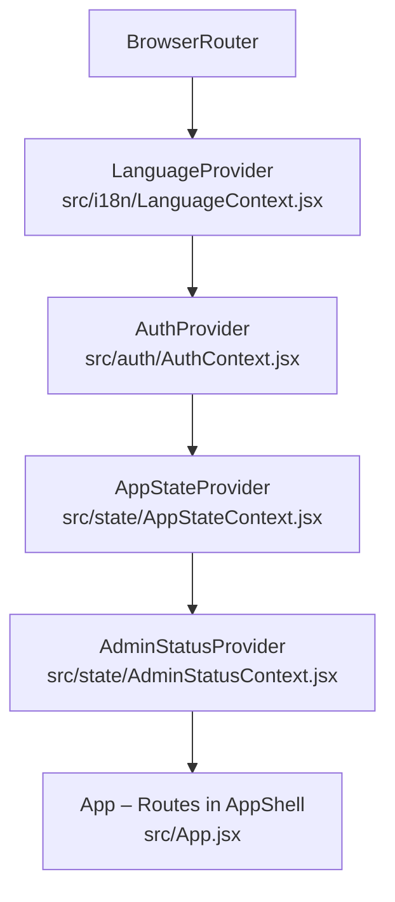
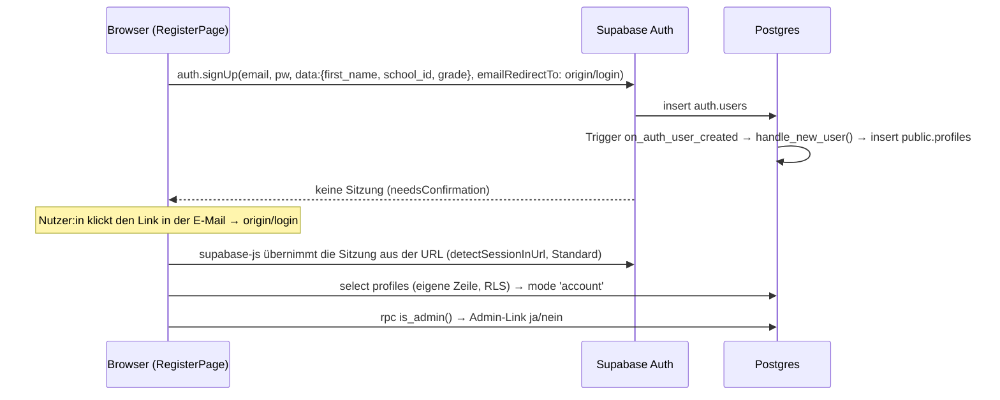
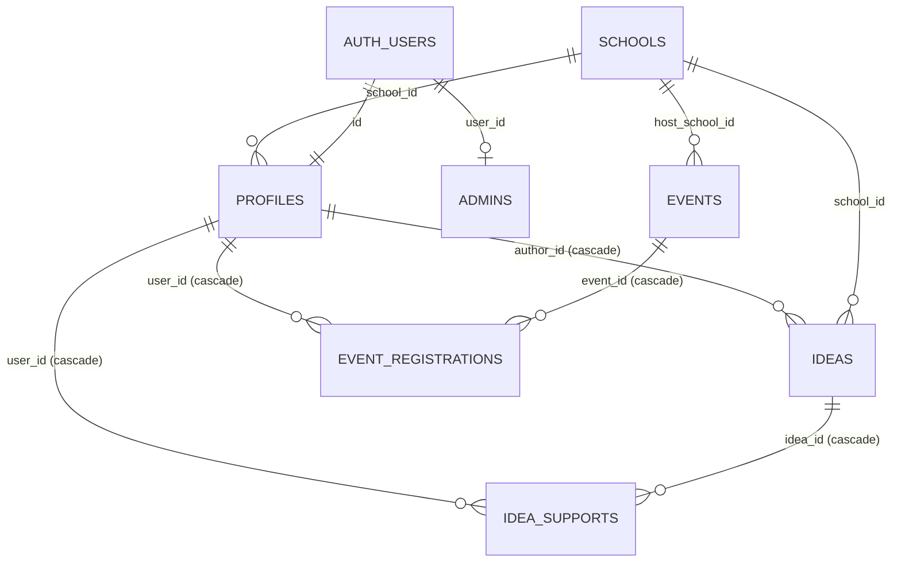
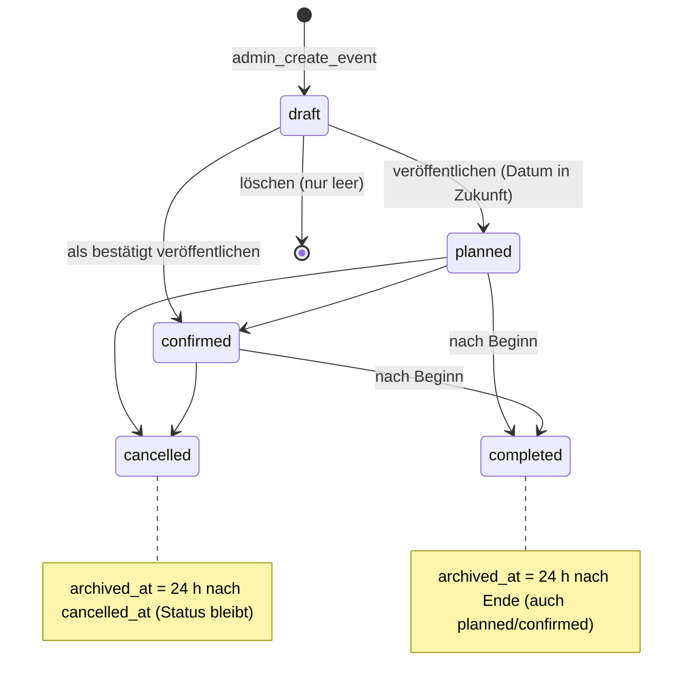
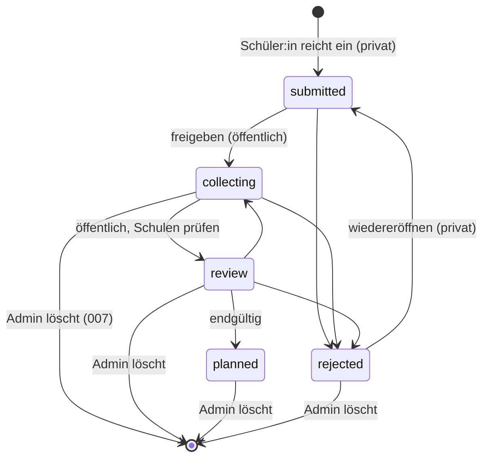

# DeutschConnect – Claude Integration Blueprint

> **Zweck:** Vollständige technische Referenz der **Claude-Version** von DeutschConnect (Branch `claude-version-1.0`),
> damit sie mit dem *Codex Integration Blueprint* (Kerems Codex-Version, Branch `codex-version-1.0`) verglichen und
> eine konfliktarme Zusammenführung vorbereitet werden kann.
>
> **Maschinenlesbare Fassung:** [`docs/integration/CLAUDE_INTEGRATION_MANIFEST.json`](integration/CLAUDE_INTEGRATION_MANIFEST.json)
> **Ergänzend:** [`docs/HANDOFF-2.md`](HANDOFF-2.md) (Sitzungsübergabe), [`docs/HANDOFF.md`](HANDOFF.md) (älter, teils veraltet)
>
> **Kennzeichnung der Aussagen**
> - **[CODE]** – im aktuellen Code dieser Version nachgewiesen (Dateipfad/Funktion angegeben)
> - **[LIVE lt. Team]** – vom Team mit echtem Supabase-Projekt im Browser getestet (laut früheren Übergaben; nicht in dieser Sitzung erneut geprüft)
> - **[LOKAL]** – nur durch Unit-Tests (nachgebauter Supabase-Client) oder Server-Rendering geprüft, **nicht** im Browser, **nicht** gegen die echte Datenbank
> - **[ANNAHME]** – plausibel, aber nicht nachgewiesen
> - **[CODEX geprüft]** – reine Leseanalyse des lokal bekannten Codex-Stands `origin/codex-version-1.0` @ `ff1c536` (kein Fetch, kein Checkout); neuere Codex-Commits sind nicht berücksichtigt
>
> Stand der Analyse: **2026-11-08**. Kein Anwendungscode wurde für diese Dokumentation verändert.

---

## Inhaltsverzeichnis

1. [Executive Summary](#1-executive-summary)
2. [Projektziel und Ausgangslage](#2-projektziel-und-ausgangslage)
3. [Git- und Repository-Status](#3-git--und-repository-status)
4. [Tech Stack und Abhängigkeiten](#4-tech-stack-und-abhängigkeiten)
5. [Repository- und Ordnerstruktur](#5-repository--und-ordnerstruktur)
6. [Frontend-Architektur](#6-frontend-architektur)
7. [Komponentenreferenz](#7-komponentenreferenz)
8. [Navigation und Routing](#8-navigation-und-routing)
9. [Designsystem](#9-designsystem)
10. [Vollständige Funktionsmatrix](#10-vollständige-funktionsmatrix)
11. [Authentifizierungsarchitektur](#11-authentifizierungsarchitektur)
12. [Backend- und API-Referenz](#12-backend--und-api-referenz)
13. [Datenbankschema](#13-datenbankschema)
14. [Datenmodelle und Beziehungen](#14-datenmodelle-und-beziehungen)
15. [Rollen und Berechtigungen](#15-rollen-und-berechtigungen)
16. [Nachrichten und Benachrichtigungen](#16-nachrichten-und-benachrichtigungen)
17. [Spiele und Leaderboards](#17-spiele-und-leaderboards)
18. [Mehrsprachigkeit](#18-mehrsprachigkeit)
19. [Datenpersistenz und Synchronisierung](#19-datenpersistenz-und-synchronisierung)
20. [Bekannte Bugs](#20-bekannte-bugs)
21. [Sicherheitsrisiken](#21-sicherheitsrisiken)
22. [Testabdeckung und Testergebnisse](#22-testabdeckung-und-testergebnisse)
23. [Wiederverwendbare Komponenten](#23-wiederverwendbare-komponenten)
24. [Schwer übertragbare Komponenten](#24-schwer-übertragbare-komponenten)
25. [Risiken bei der Integration](#25-risiken-bei-der-integration)
26. [Admin- und Moderationsmodul (Detail) und Kompatibilitätsanforderungen](#26-admin--und-moderationsmodul-detail-und-kompatibilitätsanforderungen)
27. [Deployment-Anforderungen](#27-deployment-anforderungen)
28. [Empfohlene Merge-Strategien](#28-empfohlene-merge-strategien)
29. [Priorisierter Integrationsplan](#29-priorisierter-integrationsplan)
30. [Rollback- und Wiederherstellungsstrategie](#30-rollback--und-wiederherstellungsstrategie)
31. [Offene Architekturentscheidungen](#31-offene-architekturentscheidungen)
32. [Fragen an Kerems Codex-Implementierung](#32-fragen-an-kerems-codex-implementierung)
33. [Konkrete nächste Entwicklungsschritte](#33-konkrete-nächste-entwicklungsschritte)
- [Anhang A – Übergabe an ein anderes KI-System](#anhang-a--übergabe-an-ein-anderes-ki-system)
- [Anhang B – Vergleichsleitfaden Claude ↔ Codex](#anhang-b--vergleichsleitfaden-claude--codex)
- [Anhang C – Gemeinsame Regressionstestsuite nach der Integration](#anhang-c--gemeinsame-regressionstestsuite-nach-der-integration)
- [Anhang D – Abbildung der Datenmodelle Claude ↔ Codex](#anhang-d--abbildung-der-datenmodelle-claude--codex)

---

## 1. Executive Summary

Die Claude-Version ist eine **React-19-SPA mit `react-router` 7 und `@supabase/supabase-js`**, die ein **relationales
Postgres-Schema mit Row Level Security (RLS)** direkt nutzt. Schüler:innen lesen und schreiben ihre eigenen Daten
über die Supabase-REST-API, geschützt durch RLS-Policies. Administrative Aktionen laufen **ausschließlich über
`SECURITY DEFINER`-RPC-Funktionen (`admin_*`)**, die selbst `public.is_admin()` prüfen. Admin-Rechte stehen in der
Tabelle `public.admins` (nur im SQL Editor beschreibbar). Es gibt **keine Edge Functions** und **keinen Service-Role-Key**
im Projekt.

**Stärken (für die Integration besonders wertvoll):**
- Ein **vollständiges, getestetes Admin- und Moderationsmodul** (`/admin`): Übersicht mit Kennzahlen, Event-Verwaltung
  (Entwürfe → Veröffentlichen → Bestätigen/Absagen/Abschließen, zwei Spalten Geplant/Abgesagt, Archiv), Event-Formular
  (dreisprachig, Ankara-Zeit, Kapazität), Ideen-Moderation (Freigeben/Ablehnen/Wiedereröffnen/Löschen). [CODE]
- **Sicherheitsmodell auf Datenbankebene** mit Selbstprüfungen in jeder Migration (Abbruch und Rollback bei Abweichung). [CODE]
- **Automatische Archivierung** von Events (24 h nach Absage bzw. Ende) per `pg_cron`, ohne Datenverlust. [CODE, LOKAL]
- Klare Trennung **Demo-Modus (abgemeldet)** vs. **echtes Konto**, ohne stillen Rückfall auf Demo-Daten. [CODE]
- Mehrsprachigkeit de/tr/en mit **599 Schlüsseln je Sprache**, automatisch auf Vollständigkeit getestet. [CODE]
- **267 automatisierte Tests**, alle grün; Produktions-Build erfolgreich. [LOKAL]

**Lücken:** Nachhilfe, Gruppen, Nachrichten, Meldungen/Blockierungen, Spiele, Leaderboards, Auszeichnungen und
öffentliche Profile **existieren in dieser Version nicht**. Projekte sind **nur Demo-Daten**. [CODE]

**Live-Status:** Migrationen **001–006 laut Team live**. **007–010 liegen nur lokal**; ob sie inzwischen ausgeführt
wurden, ist unbekannt. Die Admin-Oberfläche und die Status-Anzeigen für Schüler:innen wurden **nicht im Browser getestet**.

**Integrationsbefund [CODEX geprüft]:** Die Codex-Version ist grundlegend anders gebaut: Hash-Routing ohne
`react-router`, eigener REST-Client statt `supabase-js`, **ein einziger JSON-Datensatz `dc_workspace`** für alle Daten,
Schreibzugriffe nur über die Edge Function `platform` mit Service-Role-Key, Moderator:innen über die
Umgebungsvariable `DC_MODERATOR_IDS`. **Ein Git-Merge auf Dateiebene ist nicht sinnvoll.** Empfohlen wird
(vorbehaltlich der offenen Fragen in Abschnitt 32): **Claude-Architektur als Basis**, Codex-Module (Nachhilfe,
Community, Spiele, persönlicher Bereich) gezielt **portieren und auf relationale Tabellen mit RLS überführen**.

---

## 2. Projektziel und Ausgangslage

- **Ziel** (README Abschnitte 1, 7): schülergeführte, schulübergreifende Plattform; Pilot zwischen **Ernst-Reuter-Schule
  Ankara (`ers`)** und **Anka Bilim (`anka`)**; MVP = Events, Ideen, (später) Projekte; mobil zuerst; de/tr/en. [CODE: README.md]
- **Arbeitsregeln** (AGENTS.md): kleinste nötige Änderung, keine Secrets, kein Deploy oder Merge ohne Freigabe,
  fiktive Beispieldaten, keine privaten Nachrichten oder öffentlichen Schülerprofile ohne ausdrückliche Freigabe und
  Schutzmaßnahmen. [CODE: AGENTS.md]
- **Designreferenz:** FlutterFlow-Screenshots in `design references/` (neun JPEG-Dateien: Startseite, Kurse, Lehrkräfte,
  Dashboard, Impact-Seiten). AGENTS.md nennt den Pfad `docs/design-references/`; tatsächlich liegt der Ordner unter
  `design references/` im Repository-Wurzelverzeichnis. Übernommen wurden dunkles Navy, blaue Akzente, abgerundete
  Karten, Filter-Chips und Navigationsmuster – **nicht** das kommerzielle Modell oder fiktive Statistiken. [CODE: src/styles/variables.css]
- **Ausgangslage dieser Version:** Prototyp mit Demo-Daten; danach schrittweise echte Supabase-Anbindung
  (Auth → Profile → Events/Anmeldungen → Ideen/Unterstützungen → Admin → Archivierung → Übersicht → Status-Anzeigen).

---

## 3. Git- und Repository-Status

| Punkt | Wert | Quelle |
|---|---|---|
| Aktueller Branch | `claude-version-1.0` | `git branch --show-current` |
| HEAD | `9121665b98eef74ede9f3792b852180502eb8e0d` („Create HANDOFF.md“, 2026-11-08) | `git rev-parse HEAD` |
| Vorheriger Commit | `0205bcb` „Deutschconnect anthropic (claude)“ | `git log` |
| Gemeinsame Basis mit `main` und Codex | `23a6a0a` („the real stuff inside read me and agents“, 2026-11-07) | `git merge-base` |
| Remote-Branches | `origin/main`, `origin/claude-version-1.0`, `origin/codex-version-1.0` | `git branch -a` |
| Codex-Stand (lokal bekannt) | `ff1c536` „non finished codex DeutschConnect version“ (2026-11-08) | `git log origin/codex-version-1.0` |
| **Nicht committete Änderungen** | **25 geänderte, 36 neue Dateien** seit `9121665` (Liste: [HANDOFF-2 §14](HANDOFF-2.md)) – der gesamte Admin-Bereich, Migrationen 007–010 und 11 Testdateien sind **nur lokal** | `git status` |
| `.env.local` | existiert lokal, ist git-ignoriert und wurde laut `git log --all` nie committet; enthält einen `sb_publishable_…`-Key | `.gitignore`, `git log` |
| Generierte Dateien | `dist/` und `node_modules/` sind ignoriert | `.gitignore` |

**Wichtig:** Vor jeder Integration müssen die lokalen Änderungen committet und auf `origin/claude-version-1.0`
gesichert werden (nur mit Freigabe des Teams). Sonst existiert das Admin-Modul ausschließlich auf einem Laptop.

---

## 4. Tech Stack und Abhängigkeiten

| Bereich | Technologie | Version (package.json) | Bemerkung |
|---|---|---|---|
| UI | `react`, `react-dom` | `^19.1.0` | Codex: `^19.2.0` [CODEX geprüft] |
| Routing | `react-router` | `^7.6.0` | Codex: **kein** Router-Paket (Hash-Routing) [CODEX geprüft] |
| Backend-Client | `@supabase/supabase-js` | `^2.119.0` | Codex: eigener `fetch`-Client `src/services/supabase.js` [CODEX geprüft] |
| Build | `vite` | `^6.3.5` | `vite.config.js` = nur `@vitejs/plugin-react` |
| Build-Plugin | `@vitejs/plugin-react` | `^4.5.0` | |
| Tests | Node-Testrunner (`node --test`) | Node 26 lokal | keine Test-Bibliothek, kein React-Testing-Library |
| Datenbank | Supabase Postgres + RLS | – | Erweiterung `pg_cron` ab Migration 009 |
| i18n | eigene Lösung | – | `src/i18n/LanguageContext.jsx` |
| Icons | eigene Inline-SVGs | – | `src/components/Icon.jsx` |
| Schriften | Systemschriften | – | keine externen Fonts (Datenschutz) |

Skripte (`package.json`): `dev` = `vite`, `build` = `vite build`, `preview` = `vite preview`, `test` = `node --test`.
Es gibt keine Lint- und keine Typecheck-Skripte.

---

## 5. Repository- und Ordnerstruktur

```
DeutschConnect/
├─ AGENTS.md · README.md · index.html · vite.config.js · package.json · .env.example · .gitattributes · .gitignore
├─ design references/            9 JPEG-Designreferenzen (FlutterFlow-Prototyp)
├─ docs/
│  ├─ HANDOFF.md                 ältere Übergabe (teils veraltet)
│  ├─ HANDOFF-2.md               aktuelle Übergabe
│  ├─ CLAUDE_INTEGRATION_BLUEPRINT.md   (diese Datei)
│  └─ integration/CLAUDE_INTEGRATION_MANIFEST.json
├─ public/favicon.svg
├─ src/
│  ├─ main.jsx                   Provider-Baum
│  ├─ App.jsx                    alle Routen (react-router)
│  ├─ auth/AuthContext.jsx       Supabase-Auth + eigenes Profil
│  ├─ state/                     AppStateContext, AdminStatusContext, useAccountEvents, useAccountIdeas
│  ├─ lib/                       reine Logik + API-Wrapper (ohne React, testbar)
│  ├─ components/                gemeinsame UI (+ admin/, layout/)
│  ├─ pages/                     Seiten (+ admin/)
│  ├─ data/                      Demo-Daten + Stammdaten (Schulen, Themen)
│  ├─ i18n/                      LanguageContext, localize
│  ├─ locales/                   de.json, tr.json, en.json (je 599 Schlüssel)
│  ├─ hooks/usePageTitle.js
│  └─ styles/                    variables.css, base.css, layout.css, components.css, pages.css
├─ supabase/
│  ├─ migrations/001…010_*.sql   manuell im SQL Editor auszuführen
│  ├─ seed_test_events.sql       zwei Test-Events
│  └─ tests/*.sql, 006_testplan.md   SQL-Tests mit Rollback (auf einer Kopie ausführen)
└─ tests/*.test.js               17 Testdateien, 267 Tests
```

Umfang (gezählt): `src` ≈ 13 900 Zeilen JS/JSX/CSS, `tests` ≈ 3 800 Zeilen, `supabase/migrations` ≈ 3 000 Zeilen.
**Nicht vorhanden:** `supabase/config.toml`, `supabase/functions/`, Deployment-Konfiguration (`netlify.toml`, `vercel.json`), CI-Workflows.

---

## 6. Frontend-Architektur

### 6.1 Provider-Baum [CODE: src/main.jsx]



### 6.2 Zentraler Zustand `useAppState()` [CODE: src/state/AppStateContext.jsx]

| Modus (`mode`) | Bedingung | Datenquelle |
|---|---|---|
| `demo` | abgemeldet oder Supabase nicht konfiguriert | `src/data/*.js` + localStorage `deutschconnect.demoState` |
| `loading` | Sitzung, Profil, Events oder Ideen laden noch | `ProfileGate` (Ladebildschirm) statt App |
| `error` | Profil, Events oder Ideen nicht ladbar | `ProfileGate` mit „Erneut versuchen“/„Abmelden“ – **kein** Demo-Rückfall |
| `account` | angemeldet und alles geladen | Supabase |

Rückgabe: `{ mode, isRealAccount, user, events, getEvent, registrationSync, ideas, supportCounts, ideaSync, actions }`.
`actions`: `switchProfile`, `setRegistration`, `toggleInterest`, `toggleIdeaSupport`, `toggleProjectInterest`,
`dismissUpdate`, `addIdea` (Promise), `deleteIdea` (Promise), `resetDemo`.

- **Archiv-Filter zentral:** Im Modus `account` gilt `events = visibleToStudents(accountEvents.events, now)`; `now` wird
  alle 5 Minuten neu gesetzt (`ARCHIVE_TICK_MS`). Damit fehlen archivierte Events in **allen** Schüleransichten. [CODE]
- **Pro Konto lokal gespeichert:** Projekt-Interesse und ausgeblendete Hinweise unter
  `deutschconnect.accountState.v1.<userId>` (`src/lib/accountProfile.js`). [CODE]

### 6.3 Asynchrone Datenladeprozesse

| Hook/Funktion | Lädt | Fehlerverhalten |
|---|---|---|
| `AuthContext` → `fetchProfile(userId)` | `profiles` + Join auf `schools(name, short_name)` | `profileError` → `mode = 'error'` |
| `useAccountEvents(userId)` (`src/state/useAccountEvents.js`) | `fetchEvents` + `fetchMyRegistrations` | Status `error` → `ProfileGate`; Speicherfehler → `saveError {eventId, key}` |
| `useAccountIdeas(userId)` | `fetchIdeasState` (Ideen, eigene Unterstützungen, Zahlen) | analog |
| `AdminStatusContext` | `fetchIsAdmin` (RPC `is_admin`) | Status `error` → fail-closed |
| Admin-Seiten | `loadAdminEvents`, `loadAdminIdeas`, `loadOverviewStats`, `loadRecentActivity` | jeweils `{status, …, errorKey}` mit „Erneut prüfen“ |

Muster: `useEffect` mit Flag `active` (veraltete Antworten werden verworfen) und `reloadToken`, das bei
„Erneut versuchen“ hochgezählt wird. Es gibt kein Polling und keine Realtime-Abos. [CODE]

### 6.4 Formulare

- `RegisterPage`/`LoginPage`: `validateRegistration`/`validateLogin` (`src/lib/authValidation.js`); Fehler werden in
  i18n-Schlüssel übersetzt (`authErrorKey`). [CODE]
- `NewIdeaPage`: lokale `validate()` (Titel ≥ 5, Beschreibung ≥ 20, 1–3 Themen, ≥ 1 Schule, Datenschutz-Häkchen). [CODE]
- `AdminEventFormPage`: `validateEventForm`, `eventToForm`/`formToEventInput` (`src/lib/eventForm.js`); Fokus springt
  auf das erste fehlerhafte Feld; Datenbankfehler werden über `adminErrorKey` übersetzt. [CODE]
- Gemeinsam: `noValidate`, `aria-invalid`, `aria-describedby`, Fehlerzusammenfassung „Bitte prüfe die n markierten Felder“.

### 6.5 Fehlerbehandlung

- Datenbank- und REST-Fehler werden zentral über **Code → i18n-Schlüssel** übersetzt: `registrationErrorKey`
  (`eventsApi.js`), `ideaErrorKey` (`ideasApi.js`), `adminErrorKey` (`adminApi.js`), `authErrorKey` (`authValidation.js`).
- **Fail-closed:** Kann der Admin-Status nicht geprüft werden, gibt es keinen Zugriff. Ein unbekannter Wert in der
  Übersicht erscheint als „–“, nie als 0.

### 6.6 Responsive Design

Mobil zuerst. Untere Navigation `BottomNav` auf Smartphone und Tablet, Seitenleiste `SideNav` ab 960 px
(`--sidebar-width: 248px`), Inhaltsbreite höchstens `--content-max: 1080px`. Breakpoints siehe Abschnitt 9.

---

## 7. Komponentenreferenz

Legende Übertragbarkeit: 🟢 leicht (reine Darstellung oder reine Logik), 🟡 mittel (braucht `useI18n`/`useAppState`/Router),
🔴 eng gekoppelt (Supabase-Schema, RLS, Provider-Baum).

### 7.1 Layout

| Datei | Zweck | Eingaben | Abhängigkeiten | Übertragbarkeit |
|---|---|---|---|---|
| `src/components/layout/AppShell.jsx` | Gerüst: Skip-Link, SideNav, TopBar, `<main>`, BottomNav; Scroll nach oben und Fokus auf die Überschrift beim Seitenwechsel | `Outlet` | react-router, i18n | 🟡 |
| `src/components/layout/TopBar.jsx` | Logo, Demo-Kennzeichen, Sprachauswahl, Profilmenü | – | `useAppState` | 🟡 |
| `src/components/layout/SideNav.jsx` | Desktop-Navigation, Admin-Link nur bei `isAdmin` | – | `useAppState`, `useIsAdmin` | 🟡 |
| `src/components/layout/BottomNav.jsx` | Mobile Navigation (5 Punkte) | – | `NAV_ITEMS` | 🟢 |
| `src/components/layout/navigation.js` | `NAV_ITEMS`: `/`, `/events`, `/ideas`, `/network`, `/me` | – | – | 🟢 |

### 7.2 Gemeinsame UI-Bausteine

| Datei | Zweck / Props | Übertragbarkeit |
|---|---|---|
| `Icon.jsx` | Inline-SVG-Icons; `name`, `size`, `className` (33 Icons, Abschnitt 9) | 🟢 |
| `Badges.jsx` | `StatusBadge {type: event/idea/project/partnership, status}`, `RoleBadge`, `DemoBadge`, `SchoolTags`, `TopicTags` | 🟡 |
| `EventCard.jsx` | Schüler-Event-Karte; `event, role, reason, ownSchoolId`; Status **immer** sichtbar, Teilnahme getrennt, Absage rot | 🟡 |
| `IdeaCard.jsx` | Ideen-Karte mit `SupportButton` | 🟡 |
| `SupportButton.jsx` | Unterstützen/Entfernen mit Speicherzustand | 🔴 (`useAppState`) |
| `FilterChips.jsx` | Einzel- und Mehrfachauswahl (`aria-pressed`) | 🟢 |
| `Tabs.jsx` | Segment-Navigation über `?tab=` | 🟡 (Router) |
| `PageHeader.jsx` | h1, Untertitel, Zurück-Knopf, Seitentitel | 🟡 |
| `Section.jsx`, `EmptyState.jsx`, `InfoList.jsx`, `ListLink.jsx`, `SearchField.jsx` | allgemeine Darstellung | 🟢 |
| `Avatar.jsx`, `Logo.jsx`, `LanguageSwitcher.jsx`, `DemoNotice.jsx` | allgemeine Darstellung | 🟢/🟡 |
| `ProfileMenu.jsx`, `ProfileSwitcher.jsx`, `AccountCard.jsx`, `ProfileGate.jsx` | Konto, Demo-Profilwechsel, Lade-/Fehlerbildschirm | 🔴 |
| `QuickActions.jsx`, `UpdatesList.jsx`, `SchoolCard.jsx`, `ProjectCard.jsx` | Startseite, Netzwerk | 🟡 |

### 7.3 Admin-Komponenten (Abschnitt 26 im Detail)

| Datei | Zweck | Übertragbarkeit |
|---|---|---|
| `src/components/admin/AdminRoute.jsx` | Zugriffsschutz in der Anzeige (`login`/`loading`/`error`/`denied`/`allowed`), `Suspense` für lazy geladene Seiten | 🟡 (Router, Contexts) |
| `src/components/admin/AdminLayout.jsx` | Kennzeichnung „Admin-Bereich“, Unter-Navigation Übersicht/Events/Ideen | 🟡 |
| `src/components/admin/AdminEventCard.jsx` | Event-Karte für Admins inkl. Aktionen und Bestätigungen | 🟡 |
| `src/components/admin/AdminIdeaCard.jsx` | Ideen-Karte für Admins (Moderation, Löschen) | 🟡 |
| `src/components/admin/LocalizedTextField.jsx` | ein Text in drei Sprachen (de/tr/en) | 🟢 |

### 7.4 Seiten

| Route | Datei | Zweck | Daten |
|---|---|---|---|
| `/` | `pages/HomePage.jsx` | Begrüßung, Hinweise, Schnellzugriff, eigene Events, Empfehlungen, Ideen | `useAppState` |
| `/events` | `pages/EventsPage.jsx` | Tabs `mine`/`foryou`/`all`; im Tab „Alle“ Suche, Status-Filter (Alle/Geplant/Abgesagt), Zeitraum, Schule, Thema, Format | `selectors.js` |
| `/events/:eventId` | `pages/EventDetailPage.jsx` | Details, Teilnahme (Anmelden/Interesse/Abmelden), Hinweis bei Absage | `actions.setRegistration` |
| `/ideas` | `pages/IdeasPage.jsx` | Entdecken/Meine, Suche, Sortierung | – |
| `/ideas/new` | `pages/NewIdeaPage.jsx` | Idee einreichen | `actions.addIdea` |
| `/ideas/:ideaId` | `pages/IdeaDetailPage.jsx` | Details, Fortschritt (`ideaProgress.js`), Unterstützen, eigene Idee löschen | – |
| `/network`, `/network/schools/:schoolId`, `/network/projects/:projectId` | `NetworkPage`, `SchoolDetailPage`, `ProjectDetailPage` | Schulen (echte Stammdaten + lokale Beschreibungen), Projekte (**Demo**) | `src/data/schools.js`, `projects.js` |
| `/me`, `/me/interests`, `/me/settings` | `MePage`, `InterestsPage`, `SettingsPage` | eigener Bereich, Interessen (in `profiles.interests`), Konto, Sprache, Demo zurücksetzen | `AuthContext` |
| `/login`, `/register` | `LoginPage`, `RegisterPage` | Anmeldung und Registrierung (Registrierung nur bei `VITE_ENABLE_SIGNUP=true`) | `AuthContext` |
| `/about` | `AboutPage` | Projektinformationen | – |
| `/admin` … | `pages/admin/*` | Abschnitt 26 | `adminApi.js` |

### 7.5 Reine Logik (`src/lib/`) – meist 🟢, schema-abhängige Wrapper 🔴

| Datei | Exporte (Auswahl) | Kopplung |
|---|---|---|
| `supabaseClient.js` | `supabase`, `isSupabaseConfigured`, `checkSupabaseConnection` | 🔴 |
| `eventsApi.js` | `EVENT_COLUMNS`, `EVENT_COLUMNS_BASE`, `mapDbEvent`, `fetchEvents`, `fetchMyRegistrations`, `saveRegistration`, `planRegistrationChange`, `registrationErrorKey` | 🔴 |
| `ideasApi.js` | `PUBLIC_IDEA_STATUSES`, `mapDbIdea`, `fetchIdeasState`, `createIdea`, `addSupport`, `removeSupport`, `deleteOwnIdea`, `ideaErrorKey` | 🔴 |
| `adminApi.js` | `fetchIsAdmin`, `fetchAdminEvents`, `createAdminEvent`, `updateAdminEvent`, `setAdminEventStatus`, `deleteAdminEvent`, `fetchAdminIdeas`, `setAdminIdeaStatus`, `deleteAdminIdea`, `fetchAdminOverviewStats`, `mapAdminEvent`, `mapAdminIdea`, `mapOverviewStats`, `toEventParams`, `cleanText`, `adminErrorKey` | 🔴 |
| `selectors.js` | `isUpcoming`, `isListed`, `isPast`, `getEventRole`, `getMyEvents`, `getEventRecommendations`, `filterEvents`, `matchesStatusFilter`, `countEventsByStatusFilter`, `EVENT_STATUS_FILTERS`, `filterIdeas`, `getUpdates`, `getSupportCounts`, `getMyIdeas`, `getProjectRole`, `getMyProjects`, `getProjectRecommendations`, `byStart` | 🟢 (arbeitet auf App-Objekten) |
| `eventArchive.js` | `ARCHIVE_DELAY_MS`, `eventEndsAt`, `studentArchiveDueAt`, `isArchivedForStudents`, `visibleToStudents` | 🟢 |
| `eventForm.js` | `ankaraLocalToIso`, `isoToAnkaraLocal`, `formatAnkaraDateTime`, `toFormText`/`fromFormText`, `emptyEventForm`, `eventToForm`, `formToEventInput`, `validateEventForm`, `EVENT_TEXT_LIMITS` | 🟢 |
| `adminEvents.js` | `EVENT_ACTIONS`, `DELETE_ACTION`, `EVENT_FILTER_OPTIONS`, `EVENT_STATS`, `EVENT_GROUPS`, `eventGroupOf`, `groupEventsForFilter`, `changeEventStatus`, `removeEvent`, `saveEvent`, `loadAdminEvents`, `canDeleteEvent`, `isArchivedEvent`, … | 🟢 Logik / 🔴 RPC-Aufrufe |
| `adminIdeas.js` | `IDEA_ACTIONS`, `IDEA_DELETE_ACTION`, `IDEA_DELETABLE_STATUSES`, `moderateIdea`, `removeIdea`, `resolveIdeaConfirmation`, `loadAdminIdeas`, … | 🟢/🔴 |
| `adminOverview.js` | `OVERVIEW_STATS`, `OVERVIEW_QUICK_ACTIONS`, `loadOverviewStats`, `buildRecentActivity`, `loadRecentActivity`, `statValue` | 🟢/🔴 |
| `adminAccess.js` | `deriveAdminStatus`, `resolveAdminAccess` | 🟢 |
| `ideaProgress.js` | `ideaProgressSteps`, `ownIdeaNotice` | 🟢 |
| `accountProfile.js` | `buildAccountUser`, `sanitizeAccountData`, `ACCOUNT_STORAGE_PREFIX` | 🟡 |
| `authValidation.js` | `validateRegistration`, `validateLogin`, `buildSignUpMetadata`, `authErrorKey`, `safeRedirectPath`, `AUTH_LIMITS`, `GRADES` | 🟢 |
| `dates.js`, `format.js`, `reasons.js` | Datumsrechnung, Intl-Formatierung, Begründungstexte für Empfehlungen | 🟢 |

---

## 8. Navigation und Routing

- **Router:** `BrowserRouter` aus `react-router` 7 [CODE: src/main.jsx]; alle Routen in `src/App.jsx` innerhalb von `<AppShell>`.
- **Echte URL-Pfade** (History API), **keine Hash-Fragmente**. Filter stehen als Query-Parameter in der URL:
  `?tab=`, `?status=`, `?time=`, `?school=`, `?topic=`, `?format=`, `?q=`. Filterwechsel ersetzen den Verlaufseintrag
  (`replace: true`), damit „Zurück“ nicht durch Filterzustände läuft. [CODE: EventsPage, AdminEventsPage, AdminIdeasPage]
- **Zurück-Knopf** (`PageHeader`): `navigate(-1)`, wenn innerhalb der App navigiert wurde (`location.key !== 'default'`),
  sonst zur Elternseite (`backTo`). [CODE]
- **Auth-Redirects:**
  - Registrierung: `emailRedirectTo = ${origin}/login` [CODE: AuthContext.signUp].
  - Login: nach Erfolg zu `safeRedirectPath(location.state?.from)`, Standard `/me/settings` – nur interne Pfade erlaubt,
    `//…` und `/\…` werden abgewiesen [CODE: LoginPage, authValidation.safeRedirectPath].
  - `/admin` ohne Login leitet weiter zu `/login` mit `state.from = '/admin'` [CODE: AdminRoute].
- **Für das Deployment wichtig:** Weil `BrowserRouter` echte Pfade nutzt, muss der Hoster **alle unbekannten Pfade auf
  `index.html` umleiten** (SPA-Fallback). Sonst liefern Direktaufrufe wie `/admin/events` oder der
  E-Mail-Bestätigungslink `/login` einen 404-Fehler. Die Codex-Version nutzt `#/…` und braucht das nicht. [CODEX geprüft]
- **Kollisionen bei einer Integration:**
  - Die Hash-Routen der Codex-Version (`#/events/my`, `#/tutoring/...`) und die Pfad-Routen dieser Version
    (`/events?tab=mine`) sind unvereinbar.
  - Ein gemeinsames System muss gewählt werden. Empfehlung: `react-router` mit echten Pfaden; dazu Codex-Hash-Routen per
    Weiterleitung auf die neuen Pfade abbilden, für alte Links.
  - Der E-Mail-Bestätigungslink muss auf eine Route zeigen, die es im Ziel-Router gibt.

---

## 9. Designsystem

Alle Werte stammen aus `src/styles/variables.css` [CODE]. Es gibt nur ein dunkles Thema (`color-scheme: dark`).

| Token | Wert | Verwendung |
|---|---|---|
| `--color-bg` / `--color-bg-elevated` | `#0b1422` / `#0f1a2b` | Seitenhintergrund (auch `theme-color` in `index.html`) |
| `--color-surface` / `-2` / `-3` | `#162133` / `#1e2a3d` / `#27364d` | Karten, Eingabefelder, Hover |
| `--color-border` / `-strong` | `#28364c` / `#3a4b66` | Ränder |
| `--color-text` / `-muted` / `-subtle` | `#eef2f8` / `#a6b2c4` / `#8a98ad` | Text |
| `--color-primary` / `-strong` / `-hover` / `-text` / `-soft` | `#4a8fe7` / `#2f6fd6` / `#3b7de0` / `#82b4f6` / `rgba(74,143,231,.16)` | Akzent; `-strong` für Knöpfe mit weißem Text (Kontrast ≥ 4,5:1) |
| `--color-success` / `-soft` | `#79d4a0` / … | bestätigt, Erfolg |
| `--color-warning` / `-soft` | `#f2c46d` / … | Prüfung, Demo-Hinweise |
| `--color-danger` / `-soft` / `-strong` | `#f59a92` / … / `#c2413a` | abgesagt, Fehler, Löschen |
| `--color-focus` | `#a9cbff` | `:focus-visible`-Rahmen (3 px) |
| Radien | `sm 8px`, `md 12px`, `lg 16px`, `xl 22px`, `pill 999px` | Karten `lg`, Felder `md` |
| Schatten | `--shadow-float: 0 10px 30px rgba(0,0,0,.4)` | Menüs |
| Schrift | `--font-sans: 'Inter', 'Segoe UI', system-ui, …` (nur Systemschriften) | |
| Größen | `xs .75rem`, `sm .8125rem`, `base .9375rem`, `md 1.0625rem`, `lg 1.25rem`, `xl 1.5rem` | |
| Layout | `--topbar-height 56px`, `--bottom-nav-space 92px`, `--sidebar-width 248px`, `--content-max 1080px`, `--gutter 16px` | |

**Breakpoints** (gezählt in `src/styles/*.css`): `max-width 389px`, `420px`, `480px`; `min-width 560px`, `600px`, `720px`
(häufigster), `900px`, `960px` (Seitenleiste erscheint), `1200px` (5er-Reihe der Admin-Kennzahlen); dazu
`prefers-reduced-motion`.

**CSS-Konvention:** BEM-ähnliche Klassen (`.event-card__title`, `.admin-stat--link`), Zustände über
`aria-pressed`/`aria-current`/`aria-invalid` statt eigener Zustandsklassen; Status-Badges über `badge--{tone}`
(`neutral`, `muted`, `info`, `success`, `warning`, `danger`, `demo`, `role`).
Dateien: `base.css` (Reset, Typografie, Knöpfe `.btn`/`--primary|secondary|ghost|danger|sm|xs|block`, Formularfelder
`.field`), `layout.css` (Gerüst, Seitenleiste, Seitenkopf), `components.css` (Karten, Chips, Tabs, Hinweise, Fortschritt),
`pages.css` (seitenspezifisch inkl. Admin).

**Icons** (`Icon.jsx`, 33 Stück): `home calendar lightbulb network user users search globe chevronRight chevronLeft
chevronDown plus check star mapPin clock school heart info close filter sliders refresh sparkles mail bell folder trash
shield video arrowRight tag`.

**Mobile Muster:** untere Navigation, horizontal scrollbare Chip-Gruppen, Kartenlisten, Bestätigungsfelder direkt in
der Karte statt Modals, Mindesthöhe 44 px für Bedienelemente, Eingabefelder mit 16 px Schrift (verhindert Zoom unter iOS).

**Übertragbarkeit:** Die Tokens in `variables.css` lassen sich unverändert übernehmen. `base.css` und `components.css`
setzen auf diese Tokens auf und sind weitgehend eigenständig. Bei der Übernahme kann es Namenskonflikte mit den
Codex-Klassen geben (beide nutzen z. B. eine `EventCard`). [CODEX geprüft: drei Stylesheets in `src/styles/`]

---

## 10. Vollständige Funktionsmatrix

Status-Legende: ✅ **live** (laut Team im Browser mit echtem Supabase getestet) · 🧪 **lokal** (Unit-Tests oder
Server-Rendering, nicht live) · 🎭 **Demo/simuliert** · ⛔ **nicht vorhanden** · ⚠️ **bekanntes Problem**

### A. Authentifizierung

| Funktion | Dateien | Backend | Status | Tests |
|---|---|---|---|---|
| Registrierung (Vorname, Schule, Klasse, E-Mail, Passwort, Einwilligung) | `RegisterPage.jsx`, `AuthContext.signUp`, `authValidation.js` | `supabase.auth.signUp` mit Metadaten → Trigger `handle_new_user` legt Profil an | ✅ | `authValidation.test.js` |
| Formular nur bei `VITE_ENABLE_SIGNUP=true` | `AuthContext.isSignupEnabled` | Dashboard „Allow new users to sign up“ ist der eigentliche Schutz | ✅ | – |
| E-Mail-Bestätigung | `emailRedirectTo: ${origin}/login` | Supabase Auth | ✅ | – |
| Login / Logout | `LoginPage`, `AuthContext.signIn/signOut` | `signInWithPassword`, `signOut` | ✅ | `authValidation.test.js` |
| Sitzung wiederherstellen | `AuthContext` (`getSession` + `onAuthStateChange`) | supabase-js speichert die Sitzung im localStorage | ✅ | – |
| Profilzuordnung | `AuthContext.fetchProfile`, `accountProfile.buildAccountUser` | RLS „eigenes Profil“ | ✅ | `accountProfile.test.js` |
| Fehlerübersetzung (falsches Passwort, unbestätigt, Rate-Limit …) | `authErrorKey` | – | ✅ | ja |
| Passwort zurücksetzen | – | – | ⛔ | – |
| Gastmodus | Demo-Profile (`src/data/profiles.js`), `ProfileSwitcher` | localStorage | 🎭 | `selectors.test.js` |
| Rückleitung nach Login (`/admin`) | `safeRedirectPath` | – | 🧪 | ja |

### B. Nutzerprofile

| Funktion | Status | Details |
|---|---|---|
| Eigene Profildaten (Vorname, Klasse, Schule, Avatar-Farbe) | ✅ lesen; Bearbeiten: Grants erlauben `first_name, grade, avatar_color, interests` – UI nur für Interessen | Schule ist nicht änderbar (absichtlich) |
| Interessen | ✅ | `profiles.interests`, Warteschlange und optimistisches Speichern (`AuthContext.updateInterests`) |
| Öffentliche Profilansicht anderer | ⛔ (bewusst, AGENTS-Regel 11) | RLS: nur eigenes Profil lesbar |
| Sichtbarkeitseinstellungen | ⛔ | |
| Persönliche Aktivitäten / Statistiken | 🎭/✅ teilweise | `MePage` zählt eigene Events, Ideen und Projekte aus App-Daten |

### C. Projekte

| Funktion | Status | Details |
|---|---|---|
| Projektliste, Detail, Interesse bekunden | 🎭 | `src/data/projects.js`, Interesse lokal pro Konto; **keine DB-Tabelle** |
| Erstellen, Veröffentlichen, Mitgliedschaft, Anfragen, Abschluss | ⛔ | |

### D. Nachhilfe

⛔ nicht vorhanden. README Modul 4 beschreibt sie nur als Plan.

### E. Veranstaltungen

| Funktion | Rolle | Dateien | Backend | Status |
|---|---|---|---|---|
| Events lesen (veröffentlicht, nicht archiviert) | Schüler:in | `eventsApi.fetchEvents` | `select` auf `events` (RLS) | ✅ (vor 008); 008-Policy 🧪 |
| Anmelden / Interesse / Abmelden | Schüler:in | `EventDetailPage`, `saveRegistration` | insert/update(status)/delete `event_registrations` + Trigger | ✅ |
| Kapazität (ausgebucht) | Schüler:in | Trigger `event_registration_guard` (`DC008`) | 006 | ✅ laut Team ausgeführt; UI-Meldung 🧪 |
| Status-Filter Alle/Geplant/Abgesagt, Status und Teilnahme getrennt | Schüler:in | `EventsPage`, `EventCard`, `selectors.filterEvents` | – | 🧪 |
| Abgesagte Events 24 h sichtbar, dann archiviert | Schüler:in | `eventArchive.js`, Migration 008/009 | `pg_cron` | 🧪 (DB-Teil nicht ausgeführt) |
| Empfehlungen nach Interessen | Schüler:in | `getEventRecommendations` | – | ✅/🧪 |
| Event anlegen (Entwurf) / bearbeiten / veröffentlichen / bestätigen / absagen / abschließen / Entwurf löschen | **Admin** | `pages/admin/*`, `adminEvents.js`, `adminApi.js` | `admin_*`-RPCs (006/008) | 🧪 |
| Events von Schüler:innen vorschlagen | – | – | – | ⛔ (Ideen sind der Weg dafür) |
| Teilnahme bestätigen / Anwesenheit / Auszeichnungen | – | – | – | ⛔ |

### F. Community

⛔ Gruppen, Nachrichten, Diskussionen, Blockierungen und Meldungen gibt es nicht.
✅/🧪 Vorhanden ist **Ideen-Moderation** (Freigabe, Ablehnung, Löschen) durch Admins (Abschnitt 26).
Hinweise auf der Startseite (`getUpdates`: Einladungen, Erinnerungen, Ideen in Prüfung) sind **abgeleitet** und werden
nicht gespeichert; Einladungen gibt es nur in den Demo-Daten.

### G. Spiele

⛔ nicht vorhanden (kein Schach, Symbol Pairs, Paper Flight, Bridge Runner, keine Leaderboards).

### H. Sprachen

✅ de/tr/en mit je 599 Schlüsseln (Abschnitt 18). ⚠️ Die Übersetzungen ins Türkische und Englische sind nicht von
Muttersprachler:innen geprüft.

### I. Ideen (zusätzlich, Kernmodul dieser Version)

| Funktion | Rolle | Backend | Status |
|---|---|---|---|
| Idee einreichen (immer `submitted`, nur für Autor:in sichtbar) | Schüler:in | insert `ideas` (RLS) | ✅ |
| Fremde freigegebene Ideen unterstützen / Unterstützung entfernen | Schüler:in | `idea_supports` (RLS) | ✅ |
| Unterstützerzahlen ohne Namen | alle Angemeldeten | `get_idea_support_counts()` | ✅ |
| Eigene Idee löschen | Autor:in | delete `ideas` (Policy „eigene löschen“) | ✅ |
| Anzeige „Nicht freigegeben“ bei abgelehnter eigener Idee | Autor:in | – | 🧪 |
| Freigeben / Ablehnen / In Prüfung / Geplant / Wiedereröffnen | **Admin** | `admin_set_idea_status` | 🧪 (laut Team gab es live Freigaben vor der Admin-UI) |
| Idee löschen (nach Moderation) | **Admin** | `admin_delete_idea` (007) | 🧪, Migration nicht ausgeführt |

### J. Admin-Übersicht

| Funktion | Backend | Status |
|---|---|---|
| Kennzahlen (Schüler:innen, bevorstehende Events, Anmeldungen, zu prüfende Ideen, archivierte Events) | `admin_get_overview_stats` (010) | 🧪, Migration nicht ausgeführt |
| Schnellzugriff, Aktivitäten (neueste Events und Ideen) | `admin_list_events`, `admin_list_ideas` | 🧪 |

---

## 11. Authentifizierungsarchitektur



- **Client:** `src/lib/supabaseClient.js` – `createClient(VITE_SUPABASE_URL, VITE_SUPABASE_PUBLISHABLE_KEY)`; blockiert Keys,
  die mit `sb_secret_` beginnen oder `service_role` enthalten. [CODE]
- **Session:** von supabase-js verwaltet (localStorage, Token-Erneuerung); `AuthContext` setzt in `onAuthStateChange`
  bewusst nur Zustand und ruft dort nichts weiter auf (sonst kann es hängen). [CODE]
- **Identität:** `auth.users.id` = `profiles.id` = `event_registrations.user_id` = `ideas.author_id` = `admins.user_id`.
- **Profil-Synchronisierung:** einmalig durch den Trigger `handle_new_user` (Vorname, `school_id`, Klasse aus den
  Metadaten). Eine ungültige Schule lässt die Registrierung scheitern; die Meldung „Database error saving new user“
  wird übersetzt. [CODE]
- **Berechtigungsmodell:** Rolle `authenticated` + RLS. Admin = Eintrag in `public.admins`, geprüft ausschließlich in der DB.
- **E-Mail-Bestätigungslink:** Laut Team erfolgreich getestet (Registrierung → Bestätigung → Login). [LIVE lt. Team]
  In der Codex-Version wurde ein Fehler beim Öffnen des Bestätigungslinks gemeldet. Diese Version nutzt einen
  **anderen Ablauf** (supabase-js, Weiterleitung auf `/login`). Ob der Codex-Fehler hier auftreten kann, wurde nicht
  untersucht. **Online erneut testen**, sobald eine HTTPS-Adresse existiert, denn die Redirect-URLs sind derzeit
  `http://localhost:5173`.
- **Supabase-Dashboard (laut Übergabe):** Site URL `http://localhost:5173`, Redirect URL `http://localhost:5173/login`,
  E-Mail-Bestätigung an; Registrierung nur zum Testen öffnen.

---

## 12. Backend- und API-Referenz

Diese Version hat **keine Edge Functions**. Es gibt zwei Zugriffswege: **direkte Tabellenzugriffe durch Schüler:innen,
begrenzt durch RLS**, und **RPC-Funktionen**.

### 12.1 Direkte Tabellenzugriffe (Rolle `authenticated`)

| Aktion | Code | Tabelle / Operation | RLS-Bedingung | Fehler |
|---|---|---|---|---|
| Events lesen | `fetchEvents` | `select EVENT_COLUMNS order start_at` | Policy aus 008: veröffentlicht und nicht archiviert | `42703` → Neuversuch ohne neue Spalten |
| Eigene Anmeldungen | `fetchMyRegistrations` | `select event_id,status eq user_id` | `user_id = auth.uid()` | – |
| Anmelden / Interesse | `saveRegistration` (`insert`) | `event_registrations` | eigene ID; Event planned/confirmed und in der Zukunft; Trigger | `42501` geschlossen, `DC008` voll, `DC009`, `23505` |
| Wechsel registered↔interested | `saveRegistration` (`update status`) | nur Spalte `status` (002) | eigene Zeile; Trigger prüft den Wechsel zu `registered` | wie oben |
| Abmelden | `saveRegistration` (`delete`) | eigene Zeile | – | – |
| Profil lesen | `fetchProfile` | `profiles` + `schools` | eigenes Profil | – |
| Interessen speichern | `updateInterests` | `update profiles set interests` | eigenes Profil | Neu laden bei Fehler |
| Ideen lesen | `fetchIdeas` | `ideas` | Erlaubnisliste oder eigene (004 v3) | – |
| Idee einreichen | `createIdea` | `insert ideas` | eigene ID, `submitted`, eigene Schule | `ideaErrorKey` |
| Eigene Idee löschen | `deleteOwnIdea` | `delete ideas … returning id` | `author_id = auth.uid()` | `not_deleted` |
| Unterstützen / entfernen | `addSupport` / `removeSupport` | `idea_supports` | eigene ID, fremde Idee, öffentlicher Status | `23505` |
| Schulen (Registrierung) | `RegisterPage.useSchoolOptions` | `select id,name from schools` (auch `anon`, 003) | – | Rückfall `src/data/schools.js` |

### 12.2 RPC-Referenz

Alle `admin_*`-Funktionen: `SECURITY DEFINER`, `search_path = ''`, prüfen zuerst `public.is_admin()`
(sonst `42501`), sind für `PUBLIC`/`anon` gesperrt und für `authenticated` (und `service_role`, Supabase-Standard)
aufrufbar.

| RPC | Wrapper | Eingaben | Ausgabe | Datenänderung | Fehler | Migration | Tests |
|---|---|---|---|---|---|---|---|
| `is_admin()` | `fetchIsAdmin` | – | boolean | – | – | 005 | `adminApi.test.js`, `admin_role_test.sql` |
| `get_idea_support_counts()` | `fetchSupportCounts` | – | `(idea_id, supporters)[]` | – | – | 001/004 | `ideasApi.test.js` |
| `admin_list_events()` | `fetchAdminEvents` | – | Events + `registered_count`, `interested_count`, ab 008 `cancelled_at`, `archived_at` | – | 42501 | 006 / 008 | `adminApi`, `adminEvents` |
| `admin_create_event(p_title, p_start_at, p_host_school_id, p_school_ids, p_summary, p_description, p_location, p_audience, p_duration_minutes, p_capacity, p_online, p_topics, p_format)` | `createAdminEvent` | 13 Felder (jsonb/timestamptz/text/int/bool/text[]) | uuid | insert `events` mit `status = 'draft'` | 22023, 42501 | 006 | ja |
| `admin_update_event(p_id, …13…)` | `updateAdminEvent` | **alle** Felder | void | update `events` (nie Status); ab 008 wird `archived_at` bei geändertem Datum oder Dauer neu berechnet | 22023, P0002, DC002, DC005, DC006, DC009 | 006 / 008 | ja |
| `admin_set_event_status(p_id, p_status)` | `setAdminEventStatus` | id, Zielstatus | void | `events.status`; ab 008 `cancelled_at` | 22023, P0002, DC002, DC004, DC007, DC009 | 006 / 008 | ja |
| `admin_delete_event(p_id)` | `deleteAdminEvent` | id | void | delete **leerer** Entwurf | P0002, DC001, DC003, DC009 | 006 | ja |
| `admin_list_ideas(p_status)` | `fetchAdminIdeas` | optionaler Status | Ideen ohne `author_id` + `supporters` | – | 42501 | 006 | ja |
| `admin_set_idea_status(p_id, p_status)` | `setAdminIdeaStatus` | id, Zielstatus | void | `ideas.status` | 22023, P0002, DC004 | 006 | ja |
| `admin_delete_idea(p_id)` | `deleteAdminIdea` | id | void | delete `idea_supports` + `ideas` (nur collecting/review/planned/rejected) | 22023, P0002, DC010 | **007** | `adminIdeaDelete.test.js`, `admin_delete_idea_test.sql` |
| `admin_get_overview_stats()` | `fetchAdminOverviewStats` | – | 1 Zeile mit 5 `bigint` (`archived_events` NULL ohne 008) | – | 42501 | **010** | `adminOverview.test.js` |
| `archive_finished_events()` | – (nur `pg_cron` / SQL Editor) | – | int (Anzahl archiviert) | setzt `events.archived_at` | – | **008** | `eventArchive.test.js` (statisch), `event_archiving_test.sql` |

Interne Funktionen, über die API für niemanden aufrufbar: `event_ends_at`, `admin_is_valid_text_json`,
`admin_trim_text_json`, `admin_assert_event_input`, `event_registration_guard` (Trigger), `handle_new_user` (Trigger),
`set_updated_at` (Trigger).

**Benachrichtigungen:** Keine RPC löst eine Benachrichtigung aus; es gibt keine E-Mail- oder Push-Benachrichtigungen.

### 12.3 Fehlercode-Referenz

| Code | Bedeutung | Übersetzung |
|---|---|---|
| `42501` | nicht erlaubt / kein Admin / Anmeldung geschlossen | `admin.errors.notAllowed`, `eventDetail.errors.closed`, `ideas.errors.notAllowed` |
| `22023` | ungültige Eingabe | `admin.errors.invalid` |
| `P0002` | nicht gefunden | `admin.errors.notFound` |
| `DC001`–`DC007` | Event-Regeln (Einträge, Vergangenheit, nur Entwürfe, Statuswechsel, Kapazität, Datum gesperrt, nicht begonnen) | `admin.errors.hasEntries`, `pastDate`, `onlyDrafts`, `transition`, `capacityTooLow`, `dateLocked`, `notStarted` |
| `DC008` | ausgebucht | `eventDetail.errors.full`, `admin.errors.full` |
| `DC009` | falsche Isolationsstufe (nur READ COMMITTED) | `technical` |
| `DC010` | Idee in diesem Status nicht löschbar | `admin.errors.ideaNotDeletable` |
| `PGRST202`, `42883` | Funktion fehlt (Migration nicht ausgeführt) | `admin.errors.unavailable` |
| `42703` | Spalte fehlt (008 nicht ausgeführt) | stiller Rückfall in `fetchEvents` |
| `23505`, `23514`, `23503`, `22P02` | Duplikat / Prüfregel / Fremdschlüssel / Format | `conflict`, `alreadySupported`, `invalid` |

---

## 13. Datenbankschema

Quelle: `supabase/migrations/001…010`. **Live:** 001–006 (laut Team; 004 live als **v3**, Repo-Datei = v1).
**Nur lokal:** 007–010.

### 13.1 Tabellen

| Tabelle | Spalten (Typ, Regeln) | PK / FK |
|---|---|---|
| `schools` | `id text`, `name text`, `short_name text`, `city text`, `partnership_status text` (initiator/interest/confirmed), `created_at` | PK `id`; Daten `ers`, `anka` |
| `profiles` | `id uuid`, `first_name text 1–40`, `school_id text`, `grade smallint 5–13`, `avatar_color text #RRGGBB`, `interests text[] ≤20`, `created_at`, `updated_at` (Trigger) | PK `id` → `auth.users` cascade; `school_id` → `schools` |
| `events` | `id uuid`, `title jsonb not null`, `summary/description/location/audience jsonb`, `start_at timestamptz not null`, `duration_minutes int > 0`, `capacity int > 0`, `online bool`, `topics text[]`, `format text` (workshop/meetup/discussion/competition/online/project), `host_school_id text`, `school_ids text[] ≥1` (ohne FK), `status text` (**draft**/planned/confirmed/completed/cancelled, Standard `draft` ab 006), `created_at`, **`cancelled_at timestamptz`** (008), **`archived_at timestamptz`** (008) | PK `id`; `host_school_id` → `schools`; Prüfregeln 008: `(status='cancelled') = (cancelled_at is not null)`, `archived_at` nur bei veröffentlichten Events; Indizes `events_start_at_idx`, `events_archived_at_idx` |
| `event_registrations` | `event_id uuid`, `user_id uuid default auth.uid()`, `status text` (registered/interested), `created_at` | PK `(event_id, user_id)`; → `events` cascade, → `profiles` cascade |
| `ideas` | `id uuid`, `author_id uuid default auth.uid()`, `school_id text`, `title text 5–80`, `summary text ≤200`, `description text 20–600`, `topics text[] 1–3`, `format text`, `school_ids text[] ≥1`, `status text` (submitted/collecting/review/planned/**rejected**), `created_at` | → `profiles` cascade, → `schools` |
| `idea_supports` | `idea_id uuid`, `user_id uuid`, `created_at` | PK `(idea_id, user_id)`; → `ideas` **cascade**, → `profiles` cascade |
| `admins` | `user_id uuid`, `created_at`, `note text ≤200` | PK → `auth.users` cascade; RLS an, **keine Policy**, keine Rechte für App-Rollen |

**JSON-Strukturen:** Mehrsprachige Texte sind `{"de": "...", "tr": "...", "en": "..."}` oder ein einfacher String.
Validierung in `admin_assert_event_input`: nur die Schlüssel de/tr/en, nicht leer, Längen Titel 120, Kurzbeschreibung 300,
Beschreibung 2000, Ort und Zielgruppe 200. Die Werte werden getrimmt gespeichert.

**IDs:** `uuid` (`gen_random_uuid()`) für Events und Ideen, `auth.users.id` für Personen, `text` für Schulen.

### 13.2 Grants (Rolle `authenticated`, 001/002/003)

`select` auf schools, events, profiles; `update (first_name, grade, avatar_color, interests)` auf profiles;
`select, insert, update(status), delete` auf event_registrations; `select, insert, delete` auf ideas und idea_supports.
`anon`: nur `select (id, name, short_name, city)` auf schools (003).

### 13.3 Policies (Soll-Stand nach 008)

| Tabelle | Policy | Bedingung |
|---|---|---|
| schools | lesen für Angemeldete / öffentliche Infos (anon) | `true` |
| events | `events: lesen (veröffentlicht, nicht archiviert)` | `status in (planned, confirmed, completed, cancelled) and archived_at is null` |
| profiles | eigenes lesen / eigenes bearbeiten | `id = auth.uid()` |
| event_registrations | eigene lesen / anlegen / ändern / löschen | `user_id = auth.uid()`; anlegen nur, wenn das Event planned/confirmed ist und in der Zukunft liegt |
| ideas | `ideas: lesen (freigegeben oder eigene)` | Erlaubnisliste collecting/review/planned oder eigene (v3) |
| ideas | eigene anlegen / eigene löschen | eigene ID, `submitted`, eigene Schule / `author_id = auth.uid()` |
| idea_supports | eigene lesen / löschen; `supports: eigene anlegen` | eigene ID, fremde Idee, öffentlicher Status |

### 13.4 Trigger

| Trigger | Tabelle | Funktion | Zweck |
|---|---|---|---|
| `on_auth_user_created` | `auth.users` (after insert) | `handle_new_user()` | Profil anlegen |
| `profiles_set_updated_at` | `profiles` (before update) | `set_updated_at()` | Zeitstempel |
| `event_registrations_guard` | `event_registrations` (before insert/update) | `event_registration_guard()` | Status, Zukunft, Kapazität; `FOR NO KEY UPDATE`; nur READ COMMITTED |

### 13.5 Migrationen und Versionsverwaltung

Es gibt kein Migrations-Tool (`supabase db push` wird nicht genutzt). Die Dateien sind nummeriert und werden
**manuell** im SQL Editor ausgeführt. Jede Migration ab 004 ist **eine Transaktion mit Selbstprüfung** (`ABBRUCH: …`
→ alles zurückgerollt) und **idempotent** (lässt sich gefahrlos erneut ausführen).

| Nr. | Inhalt | Live |
|---|---|---|
| 001 | Grundschema, Grants, RLS, `handle_new_user`, `get_idea_support_counts` | ✅ |
| 002 | Anmeldung: Update nur Spalte `status` | ✅ |
| 003 | anon darf Schul-Basisdaten lesen | ✅ |
| 004 | Ideen-Moderation (Erlaubnisliste) | ✅ als v3 (Repo-Datei v1!) |
| 005 | `admins`, `is_admin()` | ✅ |
| 006 | Admin-Funktionen, `draft`/`rejected`, Anmelde-Trigger, Kapazität, interne Validierung, große Selbstprüfung | ✅ |
| 007 | `admin_delete_idea` | ❓ lokal |
| 008 | Archivierung (`cancelled_at`, `archived_at`, `event_ends_at`, `archive_finished_events`), Ersatz von `admin_set_event_status`/`admin_update_event`/`admin_list_events`, strengere events-Policy, Laufzeitprobe | ❓ lokal |
| 009 | `pg_cron`-Job `dc_archive_finished_events` (`7 * * * *`) | ❓ lokal |
| 010 | `admin_get_overview_stats` (unabhängig von 008) | ❓ lokal |

**Gleichzeitige Schreibzugriffe:**
- Anmeldungen sperren die Event-Zeile mit `FOR NO KEY UPDATE`, Admin-Änderungen mit `FOR UPDATE`. Damit kann der
  letzte freie Platz nicht doppelt vergeben werden.
- Das gilt **nur unter READ COMMITTED** (Standard von PostgreSQL und der Supabase-API); andere Isolationsstufen brechen
  mit `DC009` ab.
- Ideen-Moderation und Löschen sperren die Ideen-Zeile mit `FOR UPDATE`.

---

## 14. Datenmodelle und Beziehungen



### 14.1 Frontend-Objekte (Form, die alle Seiten erwarten)

| Objekt | Erzeugt von | Felder |
|---|---|---|
| **User** (App) | `buildAccountUser` / Demo-Profil | `id, firstName, lastName ('' bei echten Konten), schoolId, school {id,name,shortName,…}, grade, avatarColor, interests[], registrations {eventId: 'registered'/'interested'}, supportedIdeas[], projectInterest[], invitations[], dismissedUpdates[]` |
| **Event** | `mapDbEvent` | `id, title, summary, description, location, audience, start, durationMinutes, capacity, online, topics[], format, hostSchoolId, schoolIds[], status, cancelledAt, archivedAt, organizerIds[] (immer leer bei echten Events), isDemo:false` |
| **AdminEvent** | `mapAdminEvent` | Event + `createdAt, registeredCount, interestedCount` |
| **Idea** | `mapDbIdea` | `id, authorId, schoolId, title, summary, description, topics[], format, schoolIds[], status, createdAt, isDemo, isLocal` |
| **AdminIdea** | `mapAdminIdea` | wie Idea **ohne** `authorId`, plus `supporters` |
| **OverviewStats** | `mapOverviewStats` | `totalStudents, upcomingEvents, totalRegistrations, ideasPendingReview, archivedEvents` (je Zahl oder `null` = unbekannt) |
| **ActivityItem** | `buildRecentActivity` | `type ('event'/'idea'), id, title, status, createdAt, archived, to` |
| **EventForm** | `emptyEventForm` / `eventToForm` | `title/summary/description/location/audience {de,tr,en}, startLocal 'YYYY-MM-DDTHH:mm' (Ankara), durationMinutes, capacity (Strings), online, topics[], format, hostSchoolId, schoolIds[]` |
| **Project** (nur Demo) | `src/data/projects.js` | `id, isDemo, title/summary/description/nextStep {de,tr,en}, topics[], schoolIds[], memberIds[], status ('active'/'planning')` |

### 14.2 Lebenszyklen





**Sichtbarkeit von Ideen:** `submitted` und `rejected` sieht nur die Autor:in (Erlaubnisliste in RLS);
`collecting`, `review` und `planned` sind öffentlich für Angemeldete.
**Anmeldung (`event_registrations.status`):** `registered` (verbindlich, zählt für die Kapazität) oder `interested`
(unverbindlich). Wird ein Event abgesagt oder archiviert, bleibt die Zeile unverändert.

---

## 15. Rollen und Berechtigungen

| Fähigkeit | Besucher (anon) | Demo-Profil | Schüler:in (authenticated) | Admin (authenticated + `admins`) | DB-Eigentümer (SQL Editor / Cron) |
|---|---|---|---|---|---|
| Schul-Basisdaten lesen | ✅ (003) | lokal | ✅ | ✅ | ✅ |
| Veröffentlichte, nicht archivierte Events lesen | ⛔ (Demo-Daten) | Demo | ✅ RLS | ✅ (normale App) | ✅ |
| Entwürfe und archivierte Events lesen | ⛔ | ⛔ | ⛔ | ✅ nur über `admin_list_events` | ✅ |
| Eigene Anmeldung verwalten | ⛔ | lokal | ✅ | ✅ | ✅ |
| Fremde Anmeldungen sehen | ⛔ | ⛔ | ⛔ | nur Zahlen | ✅ |
| Idee einreichen / eigene löschen | ⛔ | lokal | ✅ | ✅ | ✅ |
| Fremde private Ideen sehen | ⛔ | ⛔ | ⛔ | ✅ über `admin_list_ideas` (ohne Autor:in) | ✅ |
| Events anlegen, bearbeiten, Status ändern, Entwurf löschen | ⛔ | ⛔ | ⛔ (42501) | ✅ RPC | ✅ |
| Ideen moderieren / löschen | ⛔ | ⛔ | ⛔ (42501) | ✅ RPC | ✅ |
| Kennzahlen der Übersicht | ⛔ | ⛔ | ⛔ | ✅ RPC | ✅ |
| Archivieren | ⛔ | ⛔ | ⛔ | ⛔ | ✅ (`archive_finished_events`) |
| Admins ernennen oder entfernen | ⛔ | ⛔ | ⛔ | ⛔ | ✅ (nur SQL Editor) |
| Andere Profile lesen | ⛔ | ⛔ | ⛔ | ⛔ | ✅ |

Es gibt **keine Moderator-Rolle neben Admin**, keine schulbezogenen Rechte, keine Rolle „Lehrkraft“.

---

## 16. Nachrichten und Benachrichtigungen

- ⛔ Es gibt keine Nachrichten, keinen Chat, keine Gruppen und keine gespeicherten Benachrichtigungen.
- Die Hinweise auf der Startseite (`UpdatesList`, `getUpdates` in `selectors.js`) werden **zur Laufzeit abgeleitet**:
  - Einladungen gibt es nur in den Demo-Daten.
  - Erinnerungen betreffen eigene Events in den nächsten 7 Tagen, außer abgesagten.
  - Ideen in Prüfung: eigene Ideen mit Status `review`.

  Ausblenden wird lokal gespeichert (`dismissedUpdates`).
- Bei Absagen gibt es **keine automatische Benachrichtigung**. Die Admin-Bestätigung weist ausdrücklich darauf hin.
- AGENTS.md verbietet private Nachrichten ohne ausdrückliche Freigabe und Schutzmaßnahmen. Die Community-Funktionen
  der Codex-Version (`postMessage`, `moderateMessage`, `report`, `blockPerson`) brauchen deshalb vor einer Übernahme
  eine Entscheidung zu Datenschutz und Moderation.

## 17. Spiele und Leaderboards

⛔ Nicht vorhanden. Die Codex-Version hat `src/games/` (`ChessBoard`, `ChessLobby`, `MemoryGame`, `ArcadeGame`,
`arcade.js`, `offline.js`) und Schach-Aktionen in `supabase/functions/_shared/social.js` (`challengeChess`,
`respondChess`, `startChess`, `chessMove`, `chessOfferDraw`, `chessResign`). [CODEX geprüft]
Bei einer Übernahme braucht es **neue relationale Tabellen** (Abschnitt 29, Stufe 6) oder eine bewusste Entscheidung,
Spielstände in einem separaten JSON-Speicher zu belassen.

---

## 18. Mehrsprachigkeit

- **System:** `src/i18n/LanguageContext.jsx`, ohne zusätzliche Bibliothek. `LANGUAGES = de (de-DE), tr (tr-TR), en (en-GB)`.
- **Startsprache:** gespeicherte Wahl (`localStorage 'deutschconnect.language'`), sonst Browsersprache, sonst Deutsch.
  Setzt `document.documentElement.lang`, wichtig für das türkische İ/ı. [CODE]
- **API:** `t(key, vars)` mit Platzhaltern `{name}`, Mehrzahl über `key_one`/`key_other` bei `vars.count`, Rückfall auf
  Deutsch, sonst Ausgabe des Schlüssels (mit Warnung im Entwicklungsmodus). `localize(value, language)` für Inhalte
  in der Form `{de,tr,en}` oder als String (Rückfall de, dann erster Wert). [CODE]
- **Dateien:** `src/locales/{de,tr,en}.json`, je **599 Schlüssel**, gleiche Struktur.
- **Absicherung:** `tests/i18n.test.js` prüft gleiche Schlüssel in allen Sprachen, keine leeren Texte, und dass jeder im
  Code genutzte Schlüssel existiert (inklusive dynamischer Status-Schlüssel). Jede Funktion hat zusätzlich eigene
  Übersetzungstests.
- **Codex [CODEX geprüft]:** 15 Locale-Dateien, aufgeteilt nach `modules/`, `personal/`, `platform/`, `quality/`, dazu
  Prüfskript `scripts/check-locales.mjs`. Bei einer Zusammenführung muss **ein** Schema gewählt werden (Vorschlag: die
  Codex-Aufteilung nach Bereichen übernehmen und die Schlüssel dieser Version als eigene Bereiche einordnen, z. B.
  `admin`, `events`) und es braucht **eine** gemeinsame Prüfung.
- **Offen:** TR/EN sind nicht von Muttersprachler:innen geprüft. Der Status `planned` heißt seit der letzten Änderung
  überall „Geplant“ / „Planlandı“ / „Planned“.

## 19. Datenpersistenz und Synchronisierung

| Daten | Ort | Synchronisierung |
|---|---|---|
| Sitzung | supabase-js (localStorage) | Token-Erneuerung durch supabase-js |
| Profil, Interessen | `profiles` | Interessen: optimistisch, Warteschlange, bei Fehler neu laden |
| Events, Anmeldungen | `events`, `event_registrations` | nach jeder Änderung die eigenen Anmeldungen frisch laden |
| Ideen, Unterstützungen | `ideas`, `idea_supports`, `get_idea_support_counts` | nach jeder Änderung neu laden |
| Admin-Listen | RPC | nach jeder Aktion sofort lokal aktualisieren, danach frisch laden |
| Projekt-Interesse, ausgeblendete Hinweise | localStorage `deutschconnect.accountState.v1.<userId>` | nur in diesem Browser |
| Demo-Zustand | localStorage `deutschconnect.demoState` | nur in diesem Browser |
| Sprache | localStorage `deutschconnect.language` | – |
| Admin-Status | nur Arbeitsspeicher | bei Kontowechsel verworfen |

Es gibt keine Realtime-Abos, kein Offline-Caching und keinen Service Worker. Die Codex-Version hat ein Offline-Skript
(`scripts/offline-build.mjs`, `src/games/offline.js`). [CODEX geprüft]

---

## 20. Bekannte Bugs

| # | Problem | Ort | Schwere |
|---|---|---|---|
| 1 | `004_ideas_moderation.sql` im Repo = v1 (Ausschlussliste), live = v3; ein erneutes Ausführen würde abgelehnte Ideen öffentlich machen | `supabase/migrations/004…` | **hoch** (nur bei Fehlbedienung) |
| 2 | Erfolgsmeldung nach dem Speichern eines Events kann nach einem Neuladen der Seite erneut erscheinen (`location.state`) | `AdminEventsPage` | gering |
| 3 | Fokus springt bei lazy geladenen Seiten nicht immer auf die Überschrift | `AppShell` + `Suspense` | gering (Barrierefreiheit) |
| 4 | Ladebildschirm blitzt beim Start kurz auf | `ProfileGate` | gering |
| 5 | Fehler beim Unterstützen auf Ideen-Karten nur für Screenreader sichtbar | `SupportButton` | gering |
| 6 | Bearbeiten durch zwei Admins gleichzeitig: die zuletzt gespeicherte Version gewinnt | `admin_update_event` | mittel |
| 7 | Schüler-Zahl der Übersicht zählt auch Profile unbestätigter Konten | `admin_get_overview_stats` | gering |
| 8 | Haupt-Bundle > 500 kB (Build-Warnung) | Build | gering |
| 9 | Ankara fest als UTC+3 (Frontend); die DB nutzt `Europe/Istanbul` | `eventForm.js`, `eventArchive.js` | gering (nur bei Sommerzeit-Einführung) |

Nicht getestet (also mögliche, unbekannte Bugs): die gesamte Admin-UI, die Status-Anzeigen für Schüler:innen und die
Migrationen 007–010 im Browser bzw. gegen die echte DB.

## 21. Sicherheitsrisiken

| Risiko | Bewertung / Gegenmaßnahme |
|---|---|
| Service-Role-Key im Browser | ausgeschlossen: Client blockiert ihn, Projekt nutzt keinen. **Codex braucht ihn in der Edge Function** – dort nur als Function-Secret erlaubt [CODEX geprüft] |
| Frontend-Admin-Prüfung umgehen | wirkungslos: alle Admin-Daten und -Aktionen nur über RPCs mit `is_admin()` |
| `authenticator` / App-Rollen als Mitglied des Eigentümers | durch die Selbstprüfungen von 008 und 010 abgefangen (Abbruch) |
| `VITE_ENABLE_SIGNUP=true` in `.env.local` | nach den Tests auf `false` setzen und im Dashboard die Registrierung schließen |
| Unbestätigte Konten | Supabase verlangt die Bestätigung vor dem Login (laut Dashboard-Einstellung); ein Profil entsteht trotzdem schon bei der Registrierung |
| Minderjährige / Datenschutz | kein Nachname, keine öffentlichen Profile, Admin-Listen ohne Autor:in, Übersicht nur Zahlen; **Datenschutzerklärung/Einwilligung für eine öffentliche Beta fehlen noch** |
| Doppelte Regeln (Frontend/DB) | DB ist maßgeblich; Abweichungen führen höchstens zu verständlichen Fehlermeldungen |
| Open Redirect beim Login | `safeRedirectPath` |
| Kein Audit-Log | Admin-Aktionen sind nicht nachvollziehbar → vor der Beta ergänzen (Abschnitt 31) |

## 22. Testabdeckung und Testergebnisse

**Ausgeführt in dieser Sitzung:** `npm test` → **267 Tests, 267 bestanden, 0 fehlgeschlagen, 0 übersprungen**
(Node-Testrunner, Windows, lokal). `npm run build` → erfolgreich.

| Testdatei | Bereich |
|---|---|
| `accountProfile.test.js` | Konto-User-Objekt, Absicherung des localStorage |
| `authValidation.test.js` | Formularregeln, Fehlerübersetzung, `safeRedirectPath` |
| `eventsApi.test.js` | Events/Anmeldungen laden, `saveRegistration`, Fehlercodes |
| `ideasApi.test.js` | Ideen, Unterstützungen, Löschen |
| `selectors.test.js` | Personalisierung, Filter, abgesagte Events |
| `i18n.test.js` | Vollständigkeit der Übersetzungen |
| `ideaProgress.test.js` | Fortschritt und Hinweise bei Ideen |
| `adminApi.test.js` | alle RPC-Wrapper, Parameternamen, Fehlercodes |
| `adminAccess.test.js` | Zugriffszustände, Lazy-Loading, kein localStorage |
| `adminIdeas.test.js`, `adminIdeaDelete.test.js` | Moderation, Löschen, statische Prüfung von 007 |
| `adminEvents.test.js`, `adminEventGroups.test.js`, `eventForm.test.js` | Event-Verwaltung, Spalten, Formular, Zeitzone, Kapazität |
| `eventArchive.test.js` | Archivregeln, statische Prüfung von 008/009 |
| `adminOverview.test.js` | Übersicht, statische Prüfung von 010 |
| `studentEventStatus.test.js` | Status-Filter und Statusanzeige für Schüler:innen |

**Methodik:** Nachgebauter Supabase-Client (`rpc`; `from()` wirft im Admin-Kontext), statische Quelltextprüfungen für
Sicherheitsregeln, Übersetzungstests pro Funktion. Server-Rendering mit Vite wurde zusätzlich manuell genutzt (Skripte
nicht im Repo).

**SQL-Tests** (`supabase/tests/`, nur auf einer Kopie, enden immer mit `TESTERGEBNIS` = zurückgerollt):
`ideas_rls_test.sql` (004), `admin_role_test.sql` (005), `admin_functions_test.sql` (006, mehr als 100 Prüfungen),
`006_readonly_checks.sql`, `capacity_concurrency_manual.sql` (zwei Sitzungen), `admin_delete_idea_test.sql` (007),
`event_archiving_test.sql` (008, T1–T21). Ob und wann diese Tests live liefen, ist laut Übergabe unklar.

**Nicht vorhanden:** End-to-End- und Browser-Tests, automatisierte Mehrnutzertests, mobile Tests, CI.
**Nicht getestet:** alle Funktionen seit dem Admin-Modul im Browser; Migrationen 007–010 gegen eine Datenbank.

## 23. Wiederverwendbare Komponenten

Ohne Umbau in eine andere React-App übertragbar (🟢):
- `src/lib/eventArchive.js`, `eventForm.js`, `adminAccess.js`, `ideaProgress.js`, `authValidation.js`, `dates.js`, `format.js`
- die Logikteile von `adminEvents.js`, `adminIdeas.js`, `adminOverview.js` (Statuswechsel, Gruppen, Filter, Kennzahl-Konfiguration)
- `Icon.jsx`, `FilterChips.jsx`, `EmptyState.jsx`, `Section.jsx`, `InfoList.jsx`, `SearchField.jsx`, `LocalizedTextField.jsx`
- `src/styles/variables.css` (Design-Tokens)
- die Sicherheitsmuster der Migrationen (Selbstprüfung, Erlaubnislisten, Laufzeitprobe) – auf jede neue Tabelle übertragbar
- die Testmethodik (nachgebauter Client, statische Sicherheitsprüfungen)

## 24. Schwer übertragbare Komponenten

- **Ganzer Datenzugriff** (`eventsApi`, `ideasApi`, `adminApi`, `useAccountEvents`, `useAccountIdeas`): setzt das
  relationale Schema mit RLS und die RPCs voraus. Im JSON-Speicher der Codex-Version gibt es diese nicht.
- **`AppStateContext`:** zentrale Verbindung von Demo- und Kontodaten mit der Archiv-Ausblendung.
- **`AuthContext`:** supabase-js-Sitzung, Profil aus `profiles`. Die Codex-Version hat eigenes Sitzungs- und
  Profilmanagement mit Profilen im Workspace-JSON (`displayName`, `language`). [CODEX geprüft]
- **Routing** (`App.jsx`, `AdminRoute`, `PageHeader`, `Tabs`, Query-Filter): setzt `react-router` voraus.
- **Migrationen 006–010:** ersetzen sich teilweise gegenseitig (008 ersetzt Funktionen aus 006). Die Reihenfolge ist
  verbindlich.

---

## 25. Risiken bei der Integration

Bewertung: W = Wahrscheinlichkeit, A = Auswirkung, K = Aufwand der Behebung (jeweils niedrig / mittel / hoch).
Spalte „geprüft“: ob die Aussage über die Codex-Version am Code nachgeprüft ist.

| # | Risiko | W | A | K | Gegenmaßnahme | geprüft |
|---|---|---|---|---|---|---|
| 1 | Doppelte Komponenten (`EventCard`, `IdeaCard`, `SchoolCard`, `Icon`, Home, Events, Ideas, Network …) | hoch | mittel | mittel | Pro Komponente eine Version wählen; Namen der Codex-Seiten (`Events.jsx`) und der Claude-Seiten (`EventsPage.jsx`) unterscheiden sich, Datei-Konflikte entstehen trotzdem bei `App.jsx` und Komponenten | ja |
| 2 | Routing: Hash (Codex) vs. `BrowserRouter` | sicher | hoch | mittel | Ein System wählen (Empfehlung `react-router`); alte Hash-Links umleiten; SPA-Fallback beim Hoster | ja |
| 3 | State: `AccountContext`/`DemoContext`/`localRepository` vs. `AuthContext`/`AppStateContext` | sicher | hoch | hoch | Eine Quelle der Wahrheit pro Entität; Adapter-Schicht beim Portieren | ja (Dateinamen) |
| 4 | Datenmodelle: JSON-Workspace (`profiles`, `participation`, `ideas`, `activities`, `modules.*`) vs. Tabellen | sicher | hoch | hoch | Codex-Entitäten in Tabellen überführen (Anhang D) oder zwei Speicher bewusst trennen | ja |
| 5 | Identitäten: beide nutzen `auth.users.id` | mittel | mittel | niedrig | Wenn dasselbe Supabase-Projekt genutzt wird, sind die IDs gleich; Profile zusammenführen (`displayName` vs. `first_name`) | ja |
| 6 | Doppelte Authentifizierung (supabase-js vs. eigener REST-Client) | hoch | hoch | mittel | Nur supabase-js behalten; die Codex-Funktion `resend` bei Bedarf über supabase-js nachbauen | ja |
| 7 | Mehrere Supabase-Projekte | **unbekannt** | hoch | mittel | Klären (Frage Q1); Konten und Daten ggf. migrieren | nein |
| 8 | Rollen: `public.admins` + `is_admin()` vs. `DC_MODERATOR_IDS` (Env-Variable der Edge Function) | sicher | hoch | mittel | Auf `public.admins` vereinheitlichen; Codex-Moderation auf RPCs mit `is_admin()` umstellen | ja |
| 9 | Profile: `first_name`, `grade`, `school_id`, `avatar_color`, `interests` vs. `displayName`, `schoolId`, `interests`, `customInterests`, `language`, `joinedAt` | sicher | mittel | mittel | Spalten ergänzen (`display_name`? `language`?); Entscheidung zu Klarnamen und Datenschutz | ja |
| 10 | Event-Status: `draft/planned/confirmed/completed/cancelled` + `archived_at` vs. `approval: proposal→confirmed`, `cancelled` (bool), `attendance` | sicher | hoch | mittel | Codex-`approveEvent` entspricht `draft → planned/confirmed`; Schüler-Vorschläge als eigenen Status ergänzen (Abschnitt 26.6) | ja |
| 11 | Ideen: Claude-Status vs. Codex-`lifecycle` (u. a. `withdrawn`, `deleted`) + Teilnahme-Anfragen | sicher | mittel | mittel | Abbildung in Anhang D; Codex-Projektgruppen auf Ideen beziehen | ja |
| 12 | Nachrichten und Benachrichtigungen: nur Codex (im JSON) | sicher | mittel | hoch | Eigene Tabellen + RLS + Moderation; AGENTS-Regel 11 beachten | ja |
| 13 | CSS: beide BEM-ähnlich, verschiedene Dateien und Variablen | hoch | mittel | mittel | Ein Token-Satz (`variables.css`); Codex-Stile nach Präfixen einordnen | teilweise |
| 14 | Pakete: Codex ohne Router und ohne supabase-js; React 19.1 vs. 19.2 | sicher | niedrig | niedrig | `package.json` dieser Version als Basis, React auf 19.2 heben | ja |
| 15 | Build- und Testkonfiguration: `node --test` (alle) vs. `node --test scripts/*.test.mjs` + `check`-Skripte | sicher | niedrig | niedrig | Gemeinsames `test`-Skript für beide Ordner | ja |
| 16 | Deployment: Codex braucht eine Edge Function + Secrets + CORS (`DC_ALLOWED_ORIGINS`); Claude nur statisches Hosting + SPA-Fallback | sicher | mittel | mittel | Entscheidung, ob die Edge Function bleibt | ja |
| 17 | Datenmigration: Daten im Codex-Workspace gehen beim Wechsel auf Tabellen ohne Skript verloren | mittel | hoch | mittel | Exportskript JSON → Tabellen; Schema- und Daten-Backup vorher | ja (Struktur) |
| 18 | Spielstände und Leaderboards nur im Codex-JSON | sicher | mittel | mittel | Eigene Tabellen oder bewusst ausklammern | ja |
| 19 | Zwei Datenmodelle parallel (Workspace + Tabellen) | hoch | hoch | – | **vermeiden**: führt zu doppelten Events und Ideen | – |
| 20 | Nicht committete Arbeit der Claude-Version | sicher | sehr hoch | niedrig | Vor jedem Integrationsschritt committen und pushen (mit Freigabe) | ja |

---

## 26. Admin- und Moderationsmodul (Detail) und Kompatibilitätsanforderungen

### 26.1 Aufbau

```mermaid
flowchart LR
  subgraph Browser
    SN[SideNav / ProfileMenu<br/>Admin-Link nur bei isAdmin] --> AR[AdminRoute]
    AR -->|allowed| AL[AdminLayout]
    AL --> OV[AdminOverviewPage]
    AL --> EV[AdminEventsPage]
    AL --> EF[AdminEventFormPage]
    AL --> ID[AdminIdeasPage]
    ASC[AdminStatusContext<br/>useIsAdmin] --> AR
  end
  OV & EV & EF & ID --> LIB[adminOverview / adminEvents / adminIdeas / eventForm]
  LIB --> API[adminApi.js]
  ASC --> API
  API -->|rpc| RPC[(admin_* RPCs<br/>SECURITY DEFINER<br/>is_admin())]
  RPC --> T[(events · event_registrations · ideas · idea_supports · profiles · admins)]
  CRON[pg_cron stündlich] --> ARCH[(archive_finished_events)]
  ARCH --> T
```

### 26.2 Zugriffsschutz

| Ebene | Mechanismus | Datei |
|---|---|---|
| Datenbank (maßgeblich) | `public.admins` + `is_admin()`; jede `admin_*`-Funktion prüft zuerst; EXECUTE nicht für anon/PUBLIC | 005, 006–010 |
| Status im Frontend | `fetchIsAdmin` nur bei `mode === 'account'`, einmal pro Konto, nur im Arbeitsspeicher | `src/state/AdminStatusContext.jsx` |
| Route | `resolveAdminAccess` → `login`/`loading`/`error`/`denied`/`allowed` (fail-closed) | `src/lib/adminAccess.js`, `AdminRoute.jsx` |
| Code-Auslieferung | Admin-Seiten per `React.lazy`; Schüler:innen laden sie nie | `src/App.jsx` |
| Admins verwalten | nur SQL Editor (Skript: genau ein Konto per `lower(email)`, bestätigt, Profil vorhanden) | Übergabe 005 |

### 26.3 Seiten und Funktionen

**Übersicht `/admin`** (`AdminOverviewPage.jsx`, `adminOverview.js`):
- Kopfzeile mit Vorname und Datum.
- 5 Kennzahlen mit Links: „Bevorstehend“ → `/admin/events`, „Zu prüfende Ideen“ → `/admin/ideas?status=submitted`,
  „Archiviert“ → `/admin/events?status=archived`; „Schüler:innen“ ohne Link.
- Schnellzugriff (4 Ziele).
- Aktivitäten: die 5 neuesten angelegten Events und eingereichten Ideen, ausdrücklich **kein Protokoll**.
- Zustände: Kennzahlen und Aktivitäten laden unabhängig; unbekannte Werte erscheinen als „–“; ohne 010 ein Hinweis,
  ohne 008 „Archiv nicht verfügbar“.

**Events `/admin/events`** (`AdminEventsPage.jsx`, `AdminEventCard.jsx`, `adminEvents.js`):
- 6 Kennzahlen (Gesamt, Entwurf, Geplant, Bestätigt, Abgeschlossen, Abgesagt); Filter-Chips (Alle, 5 Status,
  Archiviert) mit Zahlen.
- **Zwei Spalten:** „Geplante Events“ (planned + confirmed, nicht archiviert) | „Abgesagte Events“ (cancelled, nicht
  archiviert); darunter Entwürfe, Abgeschlossen, Archiviert. Jedes Event erscheint genau einmal (`groupEventsForFilter`).
- Karte: Datum (Ankara), Gastgeber, Ort, Format/online, Status-Badge, Badge „Archiviert“, Anmeldungen, Interessierte,
  Plätze, „Abgesagt am …“.
- Aktionen mit Bestätigung, die die Folgen erklärt: veröffentlichen, als bestätigt veröffentlichen, bestätigen,
  absagen, abschließen, Entwurf löschen (nur leer), bearbeiten.

**Formular `/admin/events/new` und `/:id/edit`** (`AdminEventFormPage.jsx`, `eventForm.js`):
- Felder: Titel, Kurzbeschreibung, Beschreibung, Ort und Zielgruppe jeweils in de/tr/en; Datum in Ankara-Zeit, wird
  zu `…+03:00`; Dauer 1–1440 Minuten; **Maximale Teilnehmerzahl** (leer = unbegrenzt, nicht unter der Anmeldezahl);
  online; Format; beteiligte Schulen; Gastgeber; Themen (höchstens 10).
- Bearbeiten **lädt und sendet alle Felder**. Bei abgesagten oder abgeschlossenen Events ist das Datum gesperrt.
- Ein neues Event ist immer ein Entwurf.

**Ideen `/admin/ideas`** (`AdminIdeasPage.jsx`, `AdminIdeaCard.jsx`, `adminIdeas.js`):
- Übersicht (wartet, sammelt, in Prüfung); Filter für alle 5 Status.
- Karten **ohne Autor:in**: Titel, Kurzbeschreibung, Beschreibung, Themen, Schulen, Unterstützerzahl, Einreichungsdatum.
- Aktionen: freigeben, ablehnen, in Prüfung geben, als geplant markieren, zurück zu „Sammelt Interesse“,
  wiedereröffnen, **Idee löschen** (nicht bei `submitted`).
- Doppelklick-Schutz (`busyRef`) und Bestätigung mit Titel.

### 26.4 Statusübergänge, die das normale Frontend kennen muss

| Admin-Aktion | Datenänderung | Wirkung bei Schüler:innen |
|---|---|---|
| Event anlegen | `events` mit `status = 'draft'` | unsichtbar |
| veröffentlichen | `draft → planned/confirmed` | sichtbar, Anmeldung möglich |
| bestätigen | `planned → confirmed` | Badge „Bestätigt“ |
| absagen | `→ cancelled`, `cancelled_at = now()` | rote Karte, „Abgesagt am …“, keine Anmeldung, bleibt 24 h sichtbar, Anmeldung bleibt gespeichert |
| abschließen | `→ completed` (nach Beginn) | unter „Vergangen“, nach Ende + 24 h archiviert |
| archivieren (Cron) | `archived_at` | überall ausgeblendet (RLS + Frontend), Daten bleiben |
| Datum/Dauer ändern | ggf. `archived_at` neu berechnet | kann wieder sichtbar werden |
| Idee freigeben | `submitted → collecting` | öffentlich, unterstützbar |
| Idee ablehnen | `→ rejected` | nur Autor:in sieht „Nicht freigegeben“ |
| Idee wiedereröffnen | `rejected → submitted` | wieder „Wartet auf Freigabe“ (privat) |
| Idee löschen | Idee + Unterstützungen gelöscht | verschwindet für alle |

### 26.5 Abgleich mit dem Admin-Bedarf der Codex-Version [CODEX geprüft]

| Codex-Aktion (`applyPlatformAction` / `social.js`) | Bedeutung (aus dem Code abgeleitet) | Entspricht in Claude | Lücke / Abstimmungsbedarf |
|---|---|---|---|
| `createEvent` (jede:r Angemeldete, `approval: 'proposal'`) | Schüler:in schlägt ein Event vor | – (nur Admins legen Events an) | **Neu:** Schüler-Vorschläge, z. B. als eigener Status `proposed` oder über Ideen |
| `approveEvent` (`approval = 'confirmed'`) | Moderator:in gibt frei | `admin_set_event_status draft → planned/confirmed` | Freigabe eines **Vorschlags** von Schüler:innen nötig |
| `confirmAttendance` | Anwesenheit bestätigen | ⛔ | neue Tabelle/Spalte `attended` |
| `awardRecognition`, `shareAwards` | Auszeichnungen | ⛔ | neue Tabelle + Admin-RPC; Wirkung auf Statistiken |
| `report`, `resolveReport` | Meldungen | ⛔ | Tabelle `reports` + Admin-RPCs + Seite „Meldungen“ |
| `moderateMessage`, `removeMessage` | Nachrichten moderieren | ⛔ | erst nach einer Entscheidung zu Nachrichten |
| `blockPerson` | Blockieren | ⛔ | Tabelle `blocks`, RLS-Auswirkungen |
| `reviewIdeaRequest`, `requestIdea`, `cancelIdeaRequest`, `leaveIdea`, `withdrawIdea`, `updateIdea`, `submitIdea` | Projekt- und Ideen-Teilnahme | teilweise (`submitIdea` ≈ Idee einreichen; Moderation über `admin_set_idea_status`) | Teilnahme-Anfragen und Mitgliedschaften gibt es nicht |
| `submitTutoring`, `updateTutoring`, `closeTutoring` | Nachhilfe | ⛔ | Tabellen und Moderationsregeln |
| `participation` | Event-Teilnahme (`joined`/`interested`) | `event_registrations` (`registered`/`interested`) | Abbildung `joined ↔ registered` |
| `preferences`, `setCommunityVisibility`, `toggleModuleInterest`, `setIdeaInterest`, `saveContactDraft` | persönliche Einstellungen | teilweise (`interests`) | Spalten bzw. Tabellen |
| Moderator-Erkennung über `DC_MODERATOR_IDS` | Env-Variable der Function | `public.admins` + `is_admin()` | **vereinheitlichen** (Empfehlung: `admins`, ggf. Spalte `role`) |

### 26.6 Funktionen, die normales Frontend und Admin-Backend gemeinsam abstimmen müssen

1. **Event-Lebenszyklus inklusive Schüler-Vorschlägen:** Statusliste, Sichtbarkeit, wer veröffentlichen darf.
2. **Ideen-Lebenszyklus und Projekt-Teilnahme:** Abbildung von Codex-`lifecycle` und Teilnahme-Anfragen.
3. **Anwesenheit und Auszeichnungen:** Datenmodell, Rechte, Wirkung auf Statistiken und Leaderboards.
4. **Meldungen, Blockierungen, Nachrichten:** Tabellen, RLS, Moderationsansicht, Datenschutz (AGENTS-Regel 11).
5. **Rollenmodell:** nur Admin, oder zusätzlich Moderator:in, Lehrkraft, Schul-Admin. Heute gibt es nur `admins` ohne Abstufung.
6. **Statistiken:** welche Kennzahlen zählen und welche Ereignisse sie verändern (z. B. Anmeldungen inklusive archivierter Events).
7. **Audit-Log** für alle Moderations- und Admin-Aktionen; fehlt in beiden Versionen bzw. ist in der Codex-Version unbekannt.
8. **Benachrichtigungen** bei Absage, Freigabe und Ablehnung; fehlen in dieser Version.

**Ausdrücklich nicht umgesetzt:** Für diese Analyse wurde kein neues Admin-Modul gebaut.

---

## 27. Deployment-Anforderungen

| Bereich | Claude-Version heute | Erforderlich für eine Online-Beta |
|---|---|---|
| Build | `npm run build` → `dist/` (statisch) | Netlify oder Vercel: Build-Befehl `npm run build`, Ausgabe `dist` |
| SPA-Fallback | **nicht konfiguriert** | Netlify `_redirects`: `/* /index.html 200`, oder Vercel-Rewrite (wegen `BrowserRouter`) |
| Umgebungsvariablen (Frontend) | `VITE_SUPABASE_URL`, `VITE_SUPABASE_PUBLISHABLE_KEY`, `VITE_ENABLE_SIGNUP` | im Hoster setzen; **nie** einen Service-Role-Key |
| Supabase Auth URLs | Site URL und Redirect auf `http://localhost:5173(/login)` | HTTPS-Produktions-URL + `/login` ergänzen; Preview-URLs nur bewusst |
| E-Mail-Versand | Standard-SMTP von Supabase (Rate-Limits, Absender von Supabase) **[ANNAHME]** | eigenes SMTP (Absender DeutschConnect), Vorlagen de/tr/en |
| CORS | entfällt (kein eigener Server; supabase-js gegen Supabase) | – (Codex-Function: `DC_ALLOWED_ORIGINS` pflegen) |
| Backend-Deploy | Migrationen manuell, keine Functions | Reihenfolge 007 → 008 → 009 → 010; `pg_cron` aktivieren |
| Staging | nicht vorhanden | **zweites Supabase-Projekt** (Staging) für SQL-Tests und Previews |
| Backups | Supabase-Plan-abhängig **[ANNAHME]** | vor jeder Migration Schema- und Datenexport |
| Monitoring | nicht vorhanden | mindestens Supabase-Logs; optional ein Fehler-Tracker (mit Datenschutzprüfung) |
| Datenschutz | Datensparsamkeit im Code | Datenschutzerklärung, Impressum, Einwilligung (Minderjährige), Auftragsverarbeitung mit Supabase |
| Rollback | Git und Migrationen mit Selbstprüfung | Abschnitt 30 |

**Priorisierte Checkliste für eine eingeschränkte Online-Beta:**
1. Lokale Arbeit committen und pushen (Freigabe).
2. Staging-Supabase anlegen; Migrationen 001–010 dort ausführen; alle SQL-Tests laufen lassen.
3. Browser-Tests mit zwei Konten (Anhang C) auf Staging.
4. Hosting einrichten (Netlify oder Vercel) inklusive SPA-Fallback und Env-Variablen; Preview nur für das Team.
5. Supabase-Auth-URLs für die HTTPS-Domain; den E-Mail-Bestätigungslink online testen.
6. Eigenes SMTP; Registrierung nur für eingeladene Personen bzw. Schul-E-Mails (Entscheidung).
7. Datenschutzerklärung, Impressum, Einwilligungstexte.
8. Audit-Log für Admin-Aktionen (Empfehlung vor der Beta).
9. Produktion: Migrationen live (007 → 010), `pg_cron` prüfen, Backup.
10. Beta mit begrenzter Nutzergruppe (ERS und Anka Bilim), Rückmeldekanal, Monitoring.

---

## 28. Empfohlene Merge-Strategien

| Kriterium | A: Codex als Basis, Claude-Teile übernehmen | B: Claude als Basis, Codex-Module portieren | C: neue Integrationsstruktur |
|---|---|---|---|
| Aufwand | hoch: Admin-Modul und RLS-Schema müssten auf JSON-Workspace und Edge Function umgebaut werden | mittel–hoch: Codex-Module brauchen Tabellen, RLS und RPCs | sehr hoch |
| Zuverlässigkeit | Workspace = ein Datensatz für alles: Konflikte (Revision, Neuversuche), Größenlimit 20 000 Zeichen pro Anfrage, alles in einem JSON | relationale Daten mit Constraints und Transaktionen | abhängig von der Ausführung |
| Sicherheit | Rechte im Function-Code; Service-Role-Key in der Function; Moderator:innen über eine Env-Variable | RLS + `SECURITY DEFINER`-RPCs mit Selbstprüfung; kein Service-Role-Key | – |
| Wiederverwendung | Codex-UI und Spiele direkt; Claude-Admin kaum | Claude-Admin, Auth und Events direkt; Codex-UI-Komponenten mit Adaptern | beides teilweise |
| DB-Kompatibilität | Live-Daten der Claude-Version (001–006) müssten in den Workspace migriert werden | Codex-Workspace-Daten müssen in Tabellen migriert werden (falls echte Daten existieren) | Neuaufbau |
| Wartbarkeit | ein großes JSON mit wachsender Logik (`platform.js`, `social.js`) | ein Schema pro Entität, testbar | gut, wenn sauber |
| Zeit bis zur Beta | mittel (Codex hat mehr Module, aber kein Admin-Modul in dieser Tiefe) | mittel (Kern und Admin sind fertig, Module folgen schrittweise) | lang |

**Vorläufige Empfehlung (mit offenen Fragen, Abschnitt 32): Variante B.**
Begründung:
- Das relationale Schema dieser Version läuft live.
- Das Sicherheitsmodell liegt auf Datenbankebene und ist mit Selbstprüfungen abgesichert.
- Das Admin-Modul hängt direkt an diesem Schema.
- Die Codex-Module lassen sich **einzeln** und mit Prioritäten portieren.

Die Variante kippt, wenn der Codex-Workspace bereits umfangreiche echte Nutzerdaten enthält oder das Team die
Edge-Function-Architektur ausdrücklich bevorzugt.

---

## 29. Priorisierter Integrationsplan

| Stufe | Voraussetzungen | Arbeitsschritte | Risiken | Erfolgsbedingung | Rückfall |
|---|---|---|---|---|---|
| 1. Sichern | Freigabe | Claude-Arbeit committen und pushen; Codex-Stand taggen; DB-Backups beider Projekte | Datenverlust lokal | beide Stände auf GitHub, Tags gesetzt | – |
| 2. Funktionen vergleichen | beide Blueprints | Funktionsmatrizen nebeneinanderlegen (Anhang B); Liste „behalten / portieren / verwerfen“ | Fehleinschätzung | vom Team unterschriebene Liste | erneut abstimmen |
| 3. Architektur festlegen | Stufe 2 | Router, Datenhaltung (Tabellen vs. Workspace), Rollenmodell, i18n-Aufteilung, CSS-Tokens entscheiden | Streit über Varianten | schriftliche Entscheidungen (Abschnitt 31) | – |
| 4. Datenmodelle und Identitäten vereinheitlichen | Stufe 3; Supabase-Projekt geklärt | Schema-Entwurf für Codex-Entitäten (Anhang D); Profilfelder zusammenführen; Migrationsskript JSON → Tabellen | Datenverlust, falsche Zuordnung | Staging mit migrierten Testdaten | Staging verwerfen |
| 5. Authentifizierung integrieren | Stufe 4 | supabase-js + `AuthContext` als einzige Auth; Registrierungsfelder abgleichen; Bestätigungslink auf Staging-HTTPS testen | Lockout, kaputte Redirects | Registrierung → Bestätigung → Login auf Staging | alte Auth-Variante wiederherstellen |
| 6. Kernmodule übernehmen | Stufe 5 | Reihenfolge: (a) persönlicher Bereich, (b) Nachhilfe, (c) Projekte und Teilnahme, (d) Community, (e) Spiele; je Modul Migration + RLS + RPC + Tests + UI | Umfang | je Modul grüne Tests + Browser-Check | Modul per Feature-Flag ausblenden |
| 7. Berechtigungen und Benachrichtigungen | Stufe 6 | `admins` (+ evtl. Rollen) für alle Moderationsaktionen; Audit-Log; Benachrichtigungstabelle | Rechte-Lücken | Sicherheits-SQL-Tests grün | Aktion deaktivieren |
| 8. Gemeinsame Tests | Stufen 6–7 | `npm test` über beide Testordner; i18n-Prüfung vereinheitlichen; SQL-Tests | Testlücken | Regressionstests (Anhang C) grün | – |
| 9. Staging-Umgebung | Stufe 8 | Hoster-Preview + Staging-Supabase | Konfigurationsfehler | Staging öffentlich nur fürs Team | – |
| 10. Zwei-Nutzer-Test | Stufe 9 | Konto A (Admin) + Konto B (Schüler:in) + ggf. C (andere Schule) durch alle Abläufe | – | Protokoll ohne Blocker | Fehler zurück an Stufe 6/7 |
| 11. Fehler beheben | Stufe 10 | priorisierte Liste | Zeit | keine Blocker offen | – |
| 12. Beta-Launch | Stufe 11 + Datenschutz | Produktion; Migrationen live; begrenzte Nutzergruppe | Last, Datenschutz | stabile Woche | Rollback (Abschnitt 30) |

---

## 30. Rollback- und Wiederherstellungsstrategie

- **Code:** Tags vor jeder Stufe (`pre-integration-claude`, `pre-integration-codex`); Integration auf einem eigenen
  Branch (`integration/…`), nie direkt auf `main`.
- **Datenbank:** Jede Migration ist transaktional mit Selbstprüfung (Abbruch = keine Änderung). Ein **Rückweg-SQL fehlt**
  für 006–010 und sollte vor dem Live-Einsatz von 008 erstellt werden: 008 rückgängig = Policy zurück auf die
  006-Fassung, Funktionen auf die 006-Fassung, Spalten **nicht** löschen (Daten erhalten), Cron-Job entfernen mit
  `select cron.unschedule('dc_archive_finished_events')`.
- **Daten:** Vor jeder Migration ein Backup bzw. Export. Archivierung ist umkehrbar mit
  `update events set archived_at = null …` (nur bewusst und mit Freigabe).
- **Funktionen:** Neue Module hinter Schaltern (Env-Variable `VITE_ENABLE_*`, wie heute `VITE_ENABLE_SIGNUP`), damit
  sie ohne Neuaufbau abschaltbar sind.

## 31. Offene Architekturentscheidungen

1. **Datenhaltung:** relationale Tabellen (Claude) oder JSON-Workspace (Codex) oder eine Übergangsphase?
2. **Routing:** `react-router` mit Pfaden oder Hash-Routing?
3. **Rollen:** nur Admin, oder Moderator:in, Lehrkraft, Schul-Admin? Wo gespeichert?
4. **Schüler-Vorschläge für Events:** über Ideen (heute) oder direkt als Event-Vorschlag (Codex)?
5. **Nachrichten und Gruppen:** ja oder nein, mit welchen Schutzmaßnahmen (AGENTS-Regel 11)?
6. **Profilfelder:** Anzeigename vs. Vorname; Sprache im Profil; Sichtbarkeit.
7. **Spiele und Leaderboards:** Teil der Beta? Datenmodell? Schulvergleich datenschutzkonform?
8. **i18n:** eine Datei pro Sprache oder Aufteilung nach Bereichen?
9. **Audit-Log** (Pflicht vor der Beta?).
10. **Schulen:** doppelte Pflege `src/data/schools.js` vs. Tabelle `schools` (Codex: Schulen im Workspace); nur noch die DB?
11. **Supabase-Projekt:** ein gemeinsames Projekt für beide Versionen?
12. **Registrierung:** offen, nur mit Einladung, oder nur mit Schul-E-Mail?

## 32. Fragen an Kerems Codex-Implementierung

1. **Q1:** Nutzt die Codex-Version **dasselbe Supabase-Projekt** wie die Claude-Version? Gibt es dort echte Nutzerdaten im `dc_workspace`?
2. Wie groß ist der Workspace aktuell, und gibt es Erfahrungen mit Konflikten (409) bei mehreren gleichzeitigen Nutzer:innen?
3. Welche Funktionen sind **live** bestätigt (laut `docs/SESSION_HANDOFF.md` §5) und welche nur lokal?
4. Ist der gemeldete Fehler beim E-Mail-Bestätigungslink behoben? Welche Redirect-URL wird genutzt (`redirect_to` = `origin + pathname`)?
5. Wer steht in `DC_MODERATOR_IDS`, und was kann eine Moderator:in genau (alle Aktionen mit `moderator`-Prüfung)?
6. Welche Statuswerte haben Events (`approval`, `cancelled`, `attendance`) und Ideen (`lifecycle`) vollständig?
7. Wie werden Auszeichnungen berechnet, und wovon hängen Leaderboards ab (Global / Meine Schule / Persönlich)?
8. Welche Daten sind „privat“ (`projectPlatform` filtert pro Nutzer:in)? Gibt es öffentliche Profile?
9. Welche Codex-Komponenten sind unabhängig vom `AccountContext` nutzbar (z. B. `UI.jsx`, `FormFields.jsx`, Spiele)?
10. Welche Tests laufen (`npm test` = `scripts/*.test.mjs`, `npm run check`), mit welchem Ergebnis?
11. Gibt es eine Deployment-Planung (Netlify oder Vercel, Function-Secrets, CORS)?
12. Gibt es Rückweg- oder Exportskripte für den Workspace?

## 33. Konkrete nächste Entwicklungsschritte

1. **Ege:** lokale Claude-Arbeit committen und pushen (nach Freigabe); Live-Status von 007–010 klären und in
   `docs/HANDOFF-2.md` nachtragen.
2. **Ege:** Browser-Tests mit Konto A und B (Anhang C) auf der Claude-Version.
3. **Kerem:** den Codex Integration Blueprint erstellen bzw. aktualisieren; die Fragen aus Abschnitt 32 beantworten.
4. **Gemeinsam:** beide Blueprints anhand von Anhang B vergleichen; die Entscheidungen aus Abschnitt 31 treffen.
5. **Ege:** Repo-Datei 004 auf v3 bringen; Rückweg-SQL für 008 vorbereiten (beides ohne Live-Ausführung).
6. **Gemeinsam:** Integrationsbranch anlegen (Anhang A, Punkt 8), Staging-Supabase anlegen.
7. Danach Stufen 4–12 aus Abschnitt 29.

---

## Anhang A – Übergabe an ein anderes KI-System

**Kurzfassung für ein KI-Entwicklungssystem:**
> Die Claude-Version von DeutschConnect (`claude-version-1.0`) ist eine React-19/Vite-SPA mit `react-router` 7 und
> `@supabase/supabase-js`. Daten liegen in **relationalen Supabase-Tabellen mit RLS**: `schools`, `profiles`, `events`,
> `event_registrations`, `ideas`, `idea_supports`, `admins`. Schüler:innen greifen direkt auf Tabellen zu, begrenzt
> durch RLS. Admins handeln **nur über `SECURITY DEFINER`-RPCs `admin_*`**, die `public.is_admin()` prüfen.
> Abgemeldet zeigt die App Demo-Daten aus `src/data/`. Der zentrale Zustand steckt in `src/state/AppStateContext.jsx`
> (`mode`: demo/loading/error/account). Archivierte Events (`archived_at`) blendet RLS aus und zusätzlich zentral
> `visibleToStudents`. Alle Logik in `src/lib/` ist rein und mit `node --test` getestet (267 Tests). Migrationen
> 001–006 sind laut Team live, 007–010 nur lokal. Nachhilfe, Community, Spiele und echte Projekte fehlen. Diese
> Bausteine hat die Codex-Version, allerdings in einem JSON-Workspace hinter einer Edge Function.

1. **Zuerst lesen:** `AGENTS.md` → `README.md` (Abschnitte 1, 6, 7) → `docs/HANDOFF-2.md` → diese Datei →
   `docs/integration/CLAUDE_INTEGRATION_MANIFEST.json` → `supabase/migrations/005`, `006`, `008` → `src/main.jsx`,
   `src/App.jsx`, `src/state/AppStateContext.jsx`, `src/lib/adminApi.js`.
2. **Interpretation:** Die DB ist maßgeblich; Regeln im Frontend sind Komfort. „Live“ bedeutet: vom Team im Browser
   bestätigt; „lokal“ bedeutet: nur Unit-Tests.
3. **Zu beantwortende Fragen:** Abschnitt 32 (an Codex) und Abschnitt 31 (an das Team).
4. **Leicht übertragbar:** Abschnitt 23. **Erfordert Entscheidungen:** Abschnitte 24, 25 und 31.
5. **Vergleich:** Anhang B (gleiche Gliederung: Funktionsmatrix, Datenmodelle, Rechte, Routing, Auth, Tests).
6. **Zuerst auszuräumende Risiken:** nicht committete Claude-Arbeit (#20), Supabase-Projekt (#7), Datenhaltung (#4/#19),
   Routing (#2), Rollen (#8).
7. **Integrationsbranch vorbereiten:** von `origin/main` (Basis `23a6a0a`) einen Branch `integration/claude-codex`
   anlegen; **Claude-Stand als Basis übernehmen**, sofern Variante B gewählt wird; Codex-Module als einzelne,
   überprüfbare Commits (pro Modul: Migration, RPC, Tests, UI) portieren; niemals `git merge codex-version-1.0` als Ganzes.
8. **Verboten ohne Freigabe:** SQL live ausführen, Migrationen anwenden, committen, pushen, mergen, deployen.

## Anhang B – Vergleichsleitfaden Claude ↔ Codex

| Vergleichspunkt | Claude (dieses Dokument) | Codex (im Codex-Blueprint nachschlagen) |
|---|---|---|
| Routing | §8: `BrowserRouter`, Query-Filter | Hash-Routing `readRoute()` in `src/App.jsx` [CODEX geprüft] |
| Auth | §11: supabase-js, `/login`-Redirect, Trigger-Profil | `src/services/supabase.js`, `AccountContext.jsx` [CODEX geprüft] |
| Datenhaltung | §13: Tabellen + RLS | `dc_workspace` (id = 1, revision, payload jsonb), `dc_commands`, `dc_commit` [CODEX geprüft] |
| Schreibweg | direkte Tabellen (RLS) + RPCs | `POST /functions/v1/platform` mit `action` + `commandId` [CODEX geprüft] |
| Rechte | §15: `admins` + `is_admin()` | `DC_MODERATOR_IDS`, `options.moderator` [CODEX geprüft] |
| Events | §14.2: Statusautomat + Archiv | `activities[]`: `approval`, `cancelled`, `attendance` [CODEX geprüft] |
| Ideen | §14.2 | `ideas[]`: `lifecycle`, `ownerId`, `participantIds` [CODEX geprüft] |
| Module | Events, Ideen, Admin | + Nachhilfe, Community, Gruppen, Nachrichten, Meldungen, Spiele, Auszeichnungen |
| Tests | 267 × `node --test tests/` | `node --test scripts/*.test.mjs` + `check`-Skripte |
| i18n | 3 Dateien, 599 Schlüssel | 15 Dateien nach Bereichen [CODEX geprüft] |
| Deployment | statisch + SPA-Fallback | statisch + Edge Function + Secrets + CORS |

## Anhang C – Gemeinsame Regressionstestsuite nach der Integration

**Automatisch:**
- `npm test` über alle Testordner, mit i18n-Vollständigkeit.
- `npm run build`.
- SQL-Rollback-Tests 004–008 auf Staging.

**Manuell im Browser, mit Konto A (Admin), B (Schüler:in ERS) und C (Schüler:in Anka Bilim), auf Smartphone und Desktop:**
1. Registrierung → Bestätigungslink (HTTPS) → Login → Profil → Logout → Sitzung nach Neuladen.
2. `/admin`: B → „Kein Zugriff“; abgemeldet → Login → zurück; A → Übersicht mit plausiblen Zahlen.
3. Event: A legt an (Entwurf, B und C sehen nichts) → veröffentlicht → B meldet sich an, C zeigt Interesse → Zahlen
   im Admin-Bereich → Bearbeiten (alle Felder bleiben) → Kapazität unter der Anmeldezahl (DC005) → Absagen (Spalte
   wechselt; B: „Event: Abgesagt / Du: Angemeldet“, Filter „Abgesagt“) → nach 24 h bzw. Cron für B weg, bei A unter „Archiviert“.
4. Volles Event (Kapazität 1): zweite Anmeldung → „ausgebucht“.
5. Idee: B reicht ein (C sieht nichts) → A gibt frei → C unterstützt, die Zahl steigt → A lehnt eine weitere Idee ab →
   B sieht „Nicht freigegeben“ → A öffnet wieder → A löscht (nach 007).
6. Sprache de/tr/en auf allen Seiten; kein seitliches Scrollen bei 360 px.
7. Danach die portierten Codex-Module: je Modul ein Zwei-Nutzer-Ablauf plus Moderationsablauf.

## Anhang D – Abbildung der Datenmodelle Claude ↔ Codex

Codex-Felder abgeleitet aus `supabase/functions/_shared/platform.js` (`emptyPlatform`, `addAccount`, `createEvent`,
`groupFor`) [CODEX geprüft]; vollständige Feldlisten im Codex-Blueprint nachschlagen.

| Codex (Workspace-JSON) | Felder (Auszug) | Claude-Gegenstück | Abbildung / Vorschlag |
|---|---|---|---|
| `profiles[userId]` | `id, displayName, schoolId, interests[], customInterests[], language, joinedAt` | `profiles` | `id` gleich (`auth.users.id`); `displayName` ↔ `first_name` (Entscheidung); `language`, `custom_interests` als neue Spalten; `joinedAt` ≈ `created_at` |
| `schools[]` | `id ('ers','anka'), initials, name, city` | `schools` | **gleiche IDs** `ers`/`anka`; `initials` ↔ `short_name` |
| `activities[]` | `id, ownerId, title, description, detail, category, hostSchoolId, schoolIds, startsAt, icon, approval ('proposal'→'confirmed'), revision, attendance{}`, `cancelled` | `events` | `startsAt` ↔ `start_at`; `category` ↔ `format`/`topics` (abgleichen); `approval: proposal` ↔ neuer Status (z. B. `proposed`) oder `draft`; `confirmed` ↔ `planned`/`confirmed`; `cancelled` ↔ `status = 'cancelled'` + `cancelled_at`; `ownerId` → neue Spalte `created_by`; `attendance` → neue Tabelle |
| `participation[userId][eventId]` | `'joined'` / `'interested'` | `event_registrations` | `joined` ↔ `registered`, `interested` ↔ `interested` |
| `ideas[]` | `ownerId, participantIds[], lifecycle ('deleted','withdrawn', …)` | `ideas` (+ fehlende Mitgliedschaften) | `ownerId` ↔ `author_id`; `participantIds` → neue Tabelle `idea_members`; `withdrawn` → neuer Status oder Löschen; `deleted` ↔ Löschen |
| `modules.groups[]` | `id, kind ('topic','project','event'), memberIds[], closed, contextId` | ⛔ | neue Tabellen `groups`, `group_members` |
| `modules.messages[]` | (siehe Codex) | ⛔ | neue Tabelle + Moderation |
| `modules.reports[]` | (siehe Codex) | ⛔ | neue Tabelle `reports` + Admin-RPCs |
| `modules.blocks[userId]` | Liste blockierter Personen | ⛔ | neue Tabelle `blocks` |
| `modules.tutoring[]` | Angebote/Gesuche | ⛔ | neue Tabellen |
| `modules.visibility[userId]`, `awardSharing[userId]`, `interests[userId]`, `contactDrafts[]` | Einstellungen | teilweise `profiles.interests` | Spalten bzw. Tabelle für Einstellungen |
| Schach / Spiele (`social.js`) | Herausforderungen, Partien | ⛔ | neue Tabellen oder bewusst ausklammern |
| `dc_commands` | Idempotenz `(actor_id, command_id)` | – (Transaktionen + Primärschlüssel) | entfällt bei relationalem Modell |
