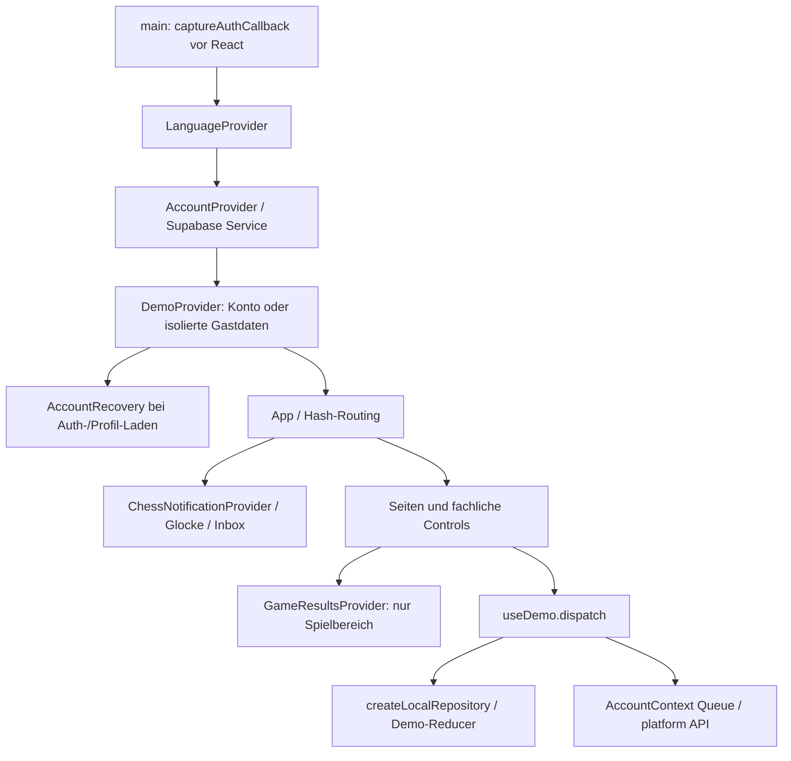
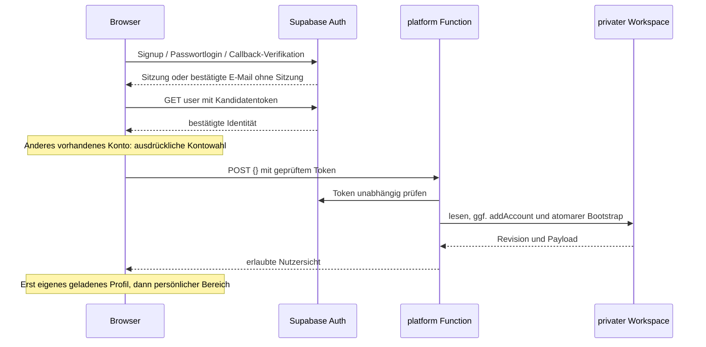
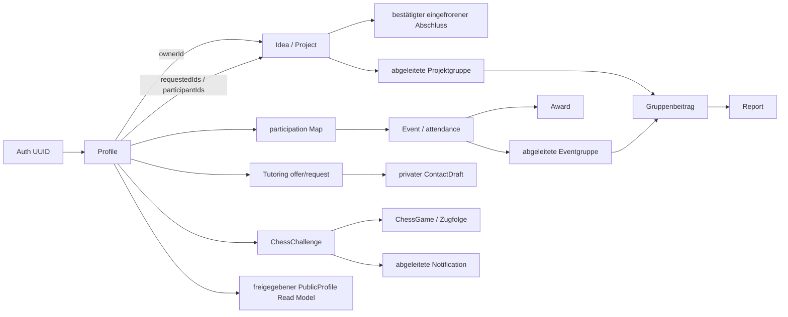

# DeutschConnect – Codex Integration Blueprint

**Analyse vom 8. November 2026, Europe/Istanbul. Dokumentationsauftrag, keine Zusammenführung.** Bezug ist der aktuelle **Arbeitsbaum einschließlich uncommitteter Auth-/UX-Korrekturen**, nicht lediglich der unten genannte Commit. Ein anderes KI-System muss diese Unterscheidung vor einer Übernahme beachten.

## Inhaltsverzeichnis

1. [Executive Summary](#1-executive-summary)
2. [Projektziel und Ausgangslage](#2-projektziel-und-ausgangslage)
3. [Git- und Repository-Status](#3-git--und-repository-status)
4. [Tech Stack und Abhängigkeiten](#4-tech-stack-und-abhängigkeiten)
5. [Repository- und Ordnerstruktur](#5-repository--und-ordnerstruktur)
6. [Frontend-Architektur](#6-frontend-architektur)
7. [Komponentenreferenz](#7-komponentenreferenz)
8. [Navigation und Routing](#8-navigation-und-routing)
9. [Designsystem](#9-designsystem)
10. [Vollständige Funktionsmatrix](#10-vollständige-funktionsmatrix)
11. [Authentifizierungsarchitektur](#11-authentifizierungsarchitektur)
12. [Backend- und API-Referenz](#12-backend--und-api-referenz)
13. [Datenbankschema](#13-datenbankschema)
14. [Datenmodelle und Beziehungen](#14-datenmodelle-und-beziehungen)
15. [Rollen und Berechtigungen](#15-rollen-und-berechtigungen)
16. [Nachrichten und Benachrichtigungen](#16-nachrichten-und-benachrichtigungen)
17. [Spiele und Leaderboards](#17-spiele-und-leaderboards)
18. [Mehrsprachigkeit](#18-mehrsprachigkeit)
19. [Datenpersistenz und Synchronisierung](#19-datenpersistenz-und-synchronisierung)
20. [Bekannte Bugs](#20-bekannte-bugs)
21. [Sicherheitsrisiken](#21-sicherheitsrisiken)
22. [Testabdeckung und Testergebnisse](#22-testabdeckung-und-testergebnisse)
23. [Wiederverwendbare Komponenten](#23-wiederverwendbare-komponenten)
24. [Schwer übertragbare Komponenten](#24-schwer-übertragbare-komponenten)
25. [Risiken bei der Integration](#25-risiken-bei-der-integration)
26. [Admin-Kompatibilitätsanforderungen](#26-admin-kompatibilitätsanforderungen)
27. [Deployment-Anforderungen](#27-deployment-anforderungen)
28. [Empfohlene Merge-Strategien](#28-empfohlene-merge-strategien)
29. [Priorisierter Integrationsplan](#29-priorisierter-integrationsplan)
30. [Rollback- und Wiederherstellungsstrategie](#30-rollback--und-wiederherstellungsstrategie)
31. [Offene Architekturentscheidungen](#31-offene-architekturentscheidungen)
32. [Fragen an Eges Claude-Implementierung](#32-fragen-an-eges-claude-implementierung)
33. [Konkrete nächste Entwicklungsschritte](#33-konkrete-nächste-entwicklungsschritte)

Vollständige technische Anhänge:

- [API, alle 42 Commands, Schema, Datenmodelle, Speicherverträge](integration/API_AND_DATA_MODELS.md)
- [Komponentenreferenz und vollständige Funktionsmatrix](integration/COMPONENTS_AND_FEATURES.md)
- [Überprüfter Claude-Vergleich, Mapping, Integrationsplan und KI-Übergabe](integration/CLAUDE_COMPARISON_AND_HANDOFF.md)
- [Maschinenlesbares Integrationsmanifest](integration/CODEX_INTEGRATION_MANIFEST.json)
- [Quellinventar mit SHA-256, Symbolen und Zeilennummern](integration/CODEX_SOURCE_INVENTORY.json)
- [Reproduzierte neue Analysebefunde](integration/CODEX_ANALYSIS_FINDINGS.json)

## 1. Executive Summary

Codex ist eine React-/Vite-SPA mit eigenem Hash-Routing, drei Sprachen und strikt getrennten Gast-/Kontorepositories. Echte Konten verwenden Supabase Auth sowie eine JWT-geprüfte Edge Function `platform`; die Funktion verwaltet einen privaten JSONB-Workspace mit atomarem CAS-Commit. Die App enthält Projekte mit Anträgen/Mitgliedschaft/Abschlussnachweisen, Events, Nachhilfe, freiwillige Profile, Gruppenbeiträge, Moderation, Schach und drei Arcade-/Gedächtnisspiele. Funktioniert lokal mit echten Oberflächen und simuliertem Auth/SQL; die vollständige aktuelle Zwei-Geräte-Cloud-Abnahme fehlt.

Die lokal vorhandene Claude-Referenz wurde **tatsächlich gelesen**, ohne Checkout/Fetch. Sie verwendet BrowserRouter, Supabase-SDK, relationale Tabellen und RLS/RPC. Das sind unterschiedliche Persistenz- und Berechtigungsmodelle. Ein Git-Merge allein kann keine sichere Integration herstellen. Besonders kritisch: **eine führende Auth-Quelle, eine Schreibautorität, explizite Status-/ID-Zuordnung und nachgewiesene Veröffentlichungsrechte**.

Neue reproduzierte Codex-Befunde: **DC-I01** liefert Eventvorschläge auch an fremde Konten und hat keine entsprechende Detail-/Listen-Sichtbarkeitssperre. **DC-I02** erlaubt serverseitig joined bei vergangenen confirmed-Events. Die bestehende Testsuite bleibt grün, deckt diese Invarianten aber nicht zuverlässig ab. Diese Dokumentation ändert den Anwendungscode nicht und gibt daher **keine Beta-Freigabe**.

## 2. Projektziel und Ausgangslage

Schülergeführte schulübergreifende Zusammenarbeit zwischen ERS Ankara und dem vorgesehenen Partner Anka Bilim. Mobile-first, navy/blau, DE/TR/EN, keine kommerzielle Nachhilfe und keine erfundenen Wirkungszahlen. Projektzweck/Designvorgaben: [README](../README.md), insbesondere Abschnitt 21; Arbeitsregeln: [AGENTS](../AGENTS.md). Wettbewerbsschluss laut Projektunterlagen 15. November 2026; externe Frist hier nicht neu verifiziert. Nicht als Grund verwenden, Datenschutz-/Rechteprüfungen zu überspringen.

Nachweisstufen dieser Dokumentation: **CODE** = aktuell gelesener Quellcode; **LOCAL** = in diesem Auftrag lokal ausgeführt; **HISTORICAL LIVE** = früher dokumentierter Cloud-Befund, heute nicht erneut cloudseitig geprüft; **CLAUDE REF** = lesend geprüfter lokaler Remote-Commit, keine Aussage über Eges aktuellen uncommitteten Stand oder Cloud; **PROPOSAL** = Integrationsvorschlag. Jede Live-Aussage ist in diesem Sinn begrenzt.

## 3. Git- und Repository-Status

| Punkt | Geprüfter Wert |
| --- | --- |
| Aktiver Branch | `codex-version-1.0` |
| HEAD | `889ad1bdf09f11da3249ba367d78f0297e40a095` |
| Claude-Referenz | `origin/claude-version-1.0`, `9121665b98eef74ede9f3792b852180502eb8e0d`, Betreff „Create HANDOFF.md“ |
| Weitere Referenzen | main, origin/main, origin/codex-version-1.0; ein aktiver Worktree |
| Remote-Frische | Kein Fetch in diesem Auftrag; lokale Referenz kann hinter Eges Stand liegen |
| Ausgangsänderungen | 25 modifizierte + 7 unversionierte Dateien aus früheren Aufträgen, exakt im Inventar unter initialGitStatus |
| Neuer Scope | Nur diese Dokumentation, Dateien unter docs/integration und Verweis in SESSION_HANDOFF; keine Anwendung-/SQL-/Testcodeänderung |

Vorbereitungsbefehle waren `git status --short`, `git branch --all`, `git rev-parse`, `git worktree list`, `git show`/`git ls-tree` für Claude. Keine Merges, Branchwechsel, Commits, Pushes, Migrationen oder Deployments. Der HEAD allein enthält die neun neuen Auth-Regressionsfälle und neuesten Auth-Komponenten möglicherweise nicht: **Arbeitsbaum-Dateien anhand des Inventars sichern/reviewen**, bevor jemand eine Integrationsbranch aus HEAD erstellt. Keine geheimen Env-Dateien kopieren. Finaler Dokumentations-/Unverändertheitsnachweis steht im Manifest.

## 4. Tech Stack und Abhängigkeiten

| Paket | package.json-Bereich | Lokal/Lock aufgelöst |
| --- | --- | --- |
| react / react-dom | ^19.2.0 | 19.3.1 |
| vite | ^7.2.0 | 7.3.7 |
| @vitejs/plugin-react | ^5.1.0 | 5.2.0 |
| @playwright/test | ^1.65.0, nur dev | 1.65.0 |

JavaScript ESM, JSX, CSS; nur Deno-Entrypoint `supabase/functions/platform/index.ts` verwendet TypeScript-Non-null-Assertions. Kein Redux, React Router, UI-Framework, Supabase-JS-SDK oder Schachpaket in Codex. HTTP über fetch, Browser-APIs Web Locks/Storage/Intl/Service Worker. React importiert absichtlich auch browserfähige reine Module aus `supabase/functions/_shared/`; beim Verschieben diese Importkanten erhalten oder gemeinsame Domänenschicht schaffen.

Lokal ausgeführt mit Node 26.13.0 / npm 11.20.0 unter Windows PowerShell; das ist ein Prüfnachweis, keine im Projekt erzwungene Runtime-Vorgabe. `package.json` hat kein engines-Feld. Für CI eine Vite-kompatible unterstützte Node-Version und Lockfile festlegen. Kein neues npm install, keine Dependency-Upgrades für diese Analyse. CLI im ignorierten lokalen Cache gehört nicht zum reproduzierbaren Frontend-Build.

## 5. Repository- und Ordnerstruktur

```text
src/main.jsx → App.jsx
src/components/    wiederverwendbare UI und fachliche Controls
src/pages/         Haupt-/Detail-/Formularseiten
src/state/         Konto-/Demo-/Notification-Kontexte, Persistenz, Navigation/Drafts
src/services/      Supabase-REST und Auth-Callback
src/data/          Fixtures, pure Selektoren, Matching, Demo-Reducer
src/games/         Schachoberfläche, drei Spiele, Ergebnisrepository/Ranking/Offline
src/i18n/          LanguageProvider und kontoangepasste Texte
src/locales/       Basis + modules/quality/personal/platform, jeweils de/tr/en
src/styles/        global.css, modules.css, games.css
supabase/functions/{platform,_shared}/
supabase/migrations/202611070001_platform.sql
supabase/tests/security.sql
scripts/           16 *.test.mjs + Sprach-/Render-/Offline-/Live-Helfer
tests/e2e/         backend.js, local.spec.js, live.spec.js
public/favicon.svg
design references/ neun JPEG-Referenzen
docs/              Berichte, Übergaben und dieser Blueprint
```

Inventar: 159 Quell-, Konfigurations-, Test-, Regel- und Referenzdateien, davon 102 unter src; enthält auch Lockfile und Bild-Hashes. `node_modules`, `.npm-cache`, `dist`, `test-results`, private Env-Dateien sind keine Lieferartefakte. Referenzpfad `docs/design-references/` aus AGENTS existiert nicht; nicht stillschweigend Dateien dorthin verschieben.

## 6. Frontend-Architektur



`AccountProvider` (`src/state/AccountContext.jsx:13`) stellt Identität, Snapshot, Fehler-/Lade-/Confirmationzustand und Aktionen bereit; `generation`/actor verhindern Übernahme verspäteter Antworten. Reloads derselben Sitzung werden zusammengeführt. `applySnapshot` vergleicht nicht nur Revision, sondern Inhalt: Rollen-/Fähigkeitsprojektion kann bei gleicher globaler Revision wechseln.

`DemoProvider` (`src/state/DemoContext.jsx:18`) ist zugleich der aktuelle Datenadapter für fast alle Seiten. Konto ohne eigenes geladenes Profil zeigt Recovery, keine erfundene Demo als Kontodaten. Gast-Persona bleibt tablokal. Es ist kein austauschbarer Presentational Context ohne Anpassung: Formulare, Interessen, Gruppen und Spiele erwarten genau seinen shape.

Formulare verwenden `useFormDraft`, validieren feldbezogen, fokussieren Fehler, warten auf bestätigte Speicherung, bewahren Draft/Anlage-ID und ignorieren späte Navigationsantworten über `useActiveView`. Passwörter werden nicht als Draft gespeichert. Fehler: lokaler Storage-Status versus Account-Servicecode versus feldbezogener Formularfehler; nicht in einen generischen Erfolgsbanner zusammenziehen.

## 7. Komponentenreferenz

[Komponentenanhang](integration/COMPONENTS_AND_FEATURES.md) beschreibt Verantwortungen, Inputs/Outputs, direkte Abhängigkeiten, State-/Services und Übertragungsrisiken. Das Inventar ergänzt Symbolzeilen für alle gelesenen Quellpfade. Wiederverwendungsklassen: **L** reine UI/Domänenfunktion, **M** Adapter für Sprache/Links/Props erforderlich, **H** eng mit Konto-/Demo-/Persistenzverträgen verbunden. Dateiname allein beweist keine Austauschbarkeit: Codex `EventCard` und Claude `EventCard` erwarten unterschiedliche Datentypen.

## 8. Navigation und Routing

Einzige Hauptnavigation: **Start / Entdecken / Nachhilfe / Community / Mein Bereich**, Quelle `src/components/Navigation.jsx:destinations`. Mobil dieselben Ziele als Bottom-Navigation, Desktop ab 1050 px im Header. Aktiver Bereich wird in App aus dem Pfad abgeleitet; Events/Ideen/Netzwerk gehören zu Entdecken. Kein zusätzlicher Hauptpunkt für Spiele oder Admin.

| Hash-Pfad ohne `#` | Bedeutung / Query / Komponenten |
| --- | --- |
| `/` | Home/Dashboard für aktives Profil |
| `/discover`, `/discover/:id` | Initiativen interviews/workshops/exchange/tutoring/projects; unbekannt → NotFound |
| `/events`, `/events/my`, `/events/recommended`, `/events/all` | Events-Listen, Standard my; Filter tablokal |
| `/events/new`, `/events/:id` | Konto-Eventvorschlag bzw. Details; `from` für Kontext |
| `/ideas`, `/ideas/my`, `/ideas/all` | Ideen/Projekte; Standard my |
| `/ideas/new?initiative=interviews`, `/ideas/:id/edit`, `/ideas/:id` | Formular/Details; `from` erlaubt |
| `/network`, `/network/collaboration`, `/network/:schoolId` | Pilot-Schulen und Kooperationsinformation |
| `/tutoring`, `/tutoring/offers`, `/tutoring/requests`, `/tutoring/my`, `/tutoring/saved` | Nachhilfe-Listen |
| `/tutoring/new?kind=offer|request`, `/tutoring/:id/edit`, `/tutoring/:id` | Nachhilfeformulare und Kontaktentwurf |
| `/community`, `/community/people`, `/community/projects`, `/community/rooms`, `/community/my` | Community; Standard people; ältere projects-Route erhalten |
| `/community/people/:id`, `/community/rooms/:id` | Freigegebenes Profil bzw. Gruppenbeiträge |
| `/community/games`, `/community/games/chess|memory|flight|runner` | Spiele und gemeinsame Bestenliste; chess optional `opponent` |
| `/community/games/chess/:gameId` | Persistierte gemeinsame/Hotseat-Partie |
| `/me` | Persönliche Übersicht und Statistik |
| `/me/activities|projects|tutoring|saved|community` | Eigene Listen, optional `view` |
| `/me/settings|account|achievements|moderation|notifications` | Profil, Login, Belege, Moderatoransicht, Schacheinladungen; moderation zusätzlich UI-Rollenprüfung |
| `/about`, unbekannte Pfade | Projektinformation bzw. NotFound |

`listenToRoutes` (`src/state/routeHistory.js:3`) hört hashchange, führt `dcRoute/dcIndex/dcPrevious`, synchronisiert auch vor Listenerstart geänderte URLs. Browser Back/Forward werden bewahrt; bestätigter Save ersetzt Formulareintrag mit `replaceRoute`, damit Back nicht ein leeres Formular öffnet. `BackLink` nutzt echte History, sonst validierten Fallback. `safeReturnTo` erlaubt nur interne Modulpfade und view/kind/initiative/opponent, kein offenes Redirect und keine verschachtelte from-Kette.

App remountet Seiten mit `route + profile.id`; Drafts/Filter stellen sich aus isoliertem sessionStorage wieder her. Nicht gespeicherte Werte bei blockiertem Storage und offene Spielergebnisse schützen Navigation. `beforeunload` bleibt für echte Seitenwechsel. Diese Mechanismen müssen bei React Router durch passende Blocker/Adapter ersetzt werden, nicht zusätzlich parallel laufen.

Auth-Fragmente kollidieren mit `#/…`: deshalb **capture vor erster Routerauswertung**. Bei BrowserRouter-Integration genau einen Callback-Consumer und eine Redirectstrategie festlegen. Alte Links und E-Mail-Links benötigen getestete Aliase, keine zwei gleichzeitig schreibenden History-Listener.

## 9. Designsystem

Quelle `src/styles/global.css:1` und neun tatsächlich gesichtete JPEGs in `design references/`. Bilder zeigen Navy, blaue Hero-Karte, runde Listen/Karten, Filterchips und schwebende Bottom-Navigation. Nur diese visuellen Muster übernehmen; frühere Preise, Unterrichts-/Spendenmodelle, persönliche Kontoinformationen und Beispiel-Erfolgszahlen gehören nicht in die gemeinsame App.

| Token / Muster | Tatsächlicher Wert |
| --- | --- |
| background / surface / raised | #091522 / #172231 / #222e3e |
| blue / blue-light | #4b91ea / #85b9ff |
| text / muted / border | #f1f4f8 / #a6b2c2 / #354151 |
| radius / content-width | 19 px / 1160 px |
| Schrift | Segoe UI Variable Display → Segoe UI → Arial → sans-serif, keine extern geladenen Fonts |
| Größen | h1 clamp 1.65–2.25 rem, h2 1.12 rem, h3 1 rem; p line-height 1.65 |
| Layout | mobile Basis min-width 320 px; oft 10/12/16/23/25 px Abstände, keine vollständige Spacing-Token-Skala |
| Breakpoints | 600, 900, 1050 px; zusätzliche <=359-px-Regel; reduced-motion-Regel |
| Touch/Fokus | meist mindestens 44 px Controls, nav 58 px; focus-visible 3 px #a5ccff, Offset 4 px; Safe-Area bei Bottom-Bar/Footer |

`modules.css`: Module, Filter/Formulare, Gruppen, Profile, persönliche Listen; `games.css`: Brett/Grid, Arcade/SVG, Tabellen. Globale Selektoren wie `button`, `a`, `h1`, `.button`, `.content-card` können Claude-CSS überschreiben. Zuerst Tokens vergleichen, Komponentenklassen namespacen/vereinheitlichen, dann Altstyles entfernen. SVG-Icons stammen aus `components/Icon.jsx`, Schachfiguren aus Unicode; keine zusätzliche Iconbibliothek nötig. UI-Primitives sind leichter übertragbar als vollständige Shell/Navigation. Sprachlängen, Keyboard, reduzierte Bewegung und reale schwächere Handys erneut prüfen.

## 10. Vollständige Funktionsmatrix

Die [Matrix im Komponentenanhang](integration/COMPONENTS_AND_FEATURES.md#funktionsmatrix) verknüpft Nutzerziel, Komponenten, Modelle, Commands, Rechte, Benachrichtigungen, Statistiken, Speicherung, Nachweis und Risiko. Sie umfasst Auth, Gastmodus, Profile/Interessen, Projektanlage/-pflege/-anträge/-abschluss, Nachhilfeangebot/Gesuch/Kontaktentwurf, Events/Freigabe/Anmeldung/Belege, Gruppen/Nachrichten/Moderation/Blocks, Schacheinladungen, alle vier Spiele/Bestenlisten, Sprachen und Offline. Kein fehlendes Modul wird durch eine Roadmap als fertig ausgewiesen.

## 11. Authentifizierungsarchitektur

Quelle `src/services/supabase.js`, `authCallback.js`, `AccountContext`, `AccountRecovery`, `ConfirmationNotice`, `Account`. [Auth-Bericht](AUTH_CONFIRMATION_FIX.md) enthält Reproduktion und konkrete Dashboard-Schritte.



Callback-Zugangsdaten bleiben bis zur Prüfung im Speicher und werden vor Rendering aus URL/History entfernt. Initialisierung teilt ein Promise auch unter StrictMode. Fehlerhafte Links erhalten keine erfundene Sitzung. Auth-UUID ist Profil-ID; fremde Benutzerangaben und Gastpersonas sind kein Identitätsnachweis. Storage nach Host getrennt; Refresh mit 45-s-Puffer, Netzwerkfehler erhalten eigene Daten, serverseitig abgewiesene Sitzung wird verworfen. Speicherblockade erlaubt Sitzung nur im RAM, nicht dauerhaft nach Reload.

Zuletzt gemeldeter Fehler: Clientfehler lokal behoben/testbelegt; **anderes physisches Gerät + ausschließlich localhost-Redirects weiterhin ungelöst**. HISTORICAL LIVE: zwei bestätigte Auth-Konten, eines ohne App-Profil; kein aktueller gültiger Testlogin, aktives HTML-Mailtemplate nicht verifiziert. Exakte damalige fehlgeschlagene Profilanfrage unbekannt. Passwortspeicherangebot des Browsers beweist keinen Login. Passwort-Reset/Passwortänderung, MFA und Accountlöschung sind keine vorhandenen UI-Funktionen. Kein Grund, Bestätigung zur Fehlersuche abzuschalten.

## 12. Backend- und API-Referenz

[Vollständige Referenz](integration/API_AND_DATA_MODELS.md) dokumentiert sieben Auth-Endpunkttypen, den `platform`-Transport sowie 42 tatsächliche Commands mit Inputs, Bedingungen, Wirkungen und Tests. Rollen-/Feldschutz muss dort erhalten bleiben, selbst wenn die UI neue Components verwendet. Es gibt keine REST-CRUD-Tabellen-API in Codex für den Browser. Eges relationale APIs können nicht allein durch Austausch der URL eingesetzt werden.

## 13. Datenbankschema

Codex: genau zwei eigene Tabellen `dc_workspace` und `dc_commands` plus `dc_commit`, siehe [Schemaanhang](integration/API_AND_DATA_MODELS.md#5-physisches-codex-schema). Keine JSON-FKs, kein fachlicher Tabellen-Audit. RLS+Grants sperren Rohzugriff; Function verwendet server_role. Globale Revision/Advisory-Lock serialisieren Writes, keine Behauptung horizontal skalierter Zusammenarbeit.

HISTORICAL LIVE: Migration 202611070001 und Function platform Version 3 ACTIVE früher im eigenen Testprojekt geprüft/bereitgestellt; keine neue Cloud-Prüfung dieses Dokumentationsauftrags. Claude hat separat sechs lokale SQL-Migrationsdateien und ein relationales Modell. Deren Reihenfolge ist kein gemeinsames Migrationsprotokoll. Besonders **Claude 004-Datei vs. erwarteter v3-Stand in 006** prüfen, siehe Vergleich.

## 14. Datenmodelle und Beziehungen

[Feldreferenz](integration/API_AND_DATA_MODELS.md#6-workspace-und-entitäten) umfasst alle persistierten und abgeleiteten Entitäten mit optionalen Feldern, Status, Sicht und Validierung.



Kanten sind logische JSON-Beziehungen, keine behaupteten SQL-FKs. `LocalGameResult` lebt separat im Browser. `LeaderboardEntry`, `PublicProfile`, Notification und persönliche Statistik sind abgeleitet; nicht durch unabhängig gepflegte Totals duplizieren. `schoolId=ers/anka` ist eine Katalog-ID, **kein Schulberechtigungsbeleg**.

## 15. Rollen und Berechtigungen

| Rolle | Aktuelle Rechte / Grenze |
| --- | --- |
| Gast | Nur fiktive lokale Daten; keine echte Auth-/Adminidentität |
| Bestätigtes Konto | Eigene Einstellungen/Vormerkungen, berechtigte Inhalte und Commands; keine verifizierte Schule |
| Eigentümer | Objektpflege, Projektanfragen entscheiden; keine fremden Eigentümeraktionen |
| Mitglied | Kontextbezogenes Gruppenlesen/-schreiben; topic per freiwilligem Beitritt |
| Globaler Moderator | Server-Allowlist `DC_MODERATOR_IDS`; umfassenderes Lesen, Meldungsbearbeitung, Event-/Abschluss-/Anwesenheits-/Awardaktionen; Gruppenlesen verleiht nicht automatisch Postingrecht |
| service_role | Nur Function/Server; privilegierter Commit, niemals VITE-Key |

Keine eigenständige Schuladmin-/Superadminrolle oder globale Nutzer-/Schulsperre. Keine Berechtigung aus editable `user_metadata`, Anzeigenamen oder isModerator im Request. Claude `public.admins/is_admin()` ist eine andere Rollenquelle, nicht automatisch gleichbedeutend mit Codex-Moderation. Bei Integration genau eine Rollenautorität und Rechte pro Fähigkeit definieren.

„Freigegebenes/öffentliches Profil“ bedeutet bei echten Codex-Konten Sichtbarkeit für andere berechtigte **angemeldete** Konten. Es gibt keinen anonym zugänglichen öffentlichen Profilendpunkt. Gastprofile sind fiktive lokale Beispiele. Diese Grenze bei einer Übertragung ausdrücklich erhalten.

## 16. Nachrichten und Benachrichtigungen

Vorhandene „Chatfunktion“ = **Gruppenbeiträge**, keine privaten 1:1-Nachrichten. Topic-Mitgliedschaften sind gespeichert, Projekt-/Eventgruppen dynamisch abgeleitet. Nachrichtenzustellung bedeutet Sichtbarkeit nach erfolgreichem Write und dem nächsten Vier-Sekunden-Poll; kein WebSocket/Push/Read Receipt dafür. Reports sind eigene Moderationsvorgänge, Blocks persönliche Sperren.

Nur Schacheinladungen besitzen die appweite Glocke/Inbox mit pending→accepted/declined/cancelled und direkter Partie-Verbindung. Ereignisse entstehen aus Challenge-/Gamestatus, private Leseschlüssel verhindern doppelte Ungelesen-Zählung. `chessInviteEmail` erzeugt lediglich übersetzte Vorlage, HTTPS-Link und Deduplizierungsschlüssel; es löst keinen Versand aus. Keine Mail bei geschlossener Website, kein Push, kein generischer Notification-Service für Projektanträge/Events/Nachhilfe. Supabase-Auth-Mail und spätere Einladungspost sind unterschiedliche Versandaufgaben.

## 17. Spiele und Leaderboards

| Spiel | Tatsächliche Wertung | Daten / Grenzen |
| --- | --- | --- |
| Chess | Ein gültiger Sieg = 1; Niederlage/Remis 0, separat erfasst; Partie-ID einmal | Server rekonstruiert Zugfolge und Revision bei Kontopartien; hotseat nur Übung, leer/abgebrochen kein Sieg; keine ELO |
| Symbol Pairs (`memory`) | Jeder vollständige Abschluss = 1, keine Zeitwertung | 12 Karten, sechs Paare, turns>=6; lokale run-ID dedupliziert |
| Paper Flight (`flight`) | Höchster gültiger Einzelscore | speed=160+100*(1-exp(-t/80)); Spawnabstand 304/speed, Gap 130; Neustart setzt Szene/Tempo zurück |
| Bridge Runner (`runner`) | Höchster Einzelscore, keine Summierung | Geschwindigkeit 235+min(100,time*3), Score floor(time*10); vorhandene Sprungmechanik |

Alle nutzen `GameLeaderboard`, game-Auswahl und global/school/personal. **Global/Schule nur als freiwillige lokale Demo-Rangliste**, account zeigt ehrliche Backend-fehlt-Meldung; persönlich hat lokale Arcade-Rekorde und aus autorisierten Partien abgeleitete Schachstatistik. Keine echte gemeinsame globale Schachrangliste, da Projektion fremde Partien gerade nicht liefert. Ties: gleicher Score gleicher Wettbewerbsrang (1,1,3), ID als stabile Anzeige-Reihenfolge. Schule ist Selbstauskunft; unbekannte Schule ergibt leere Schulrangliste.

Reine Regeln/Ranking gut wiederverwendbar, GameResultsProvider und ChessBoard benötigen Adapter. Account-Arcade-Rekorde nicht unbemerkt als servergeprüft importieren. Details [GAMES-LEADERBOARDS](GAMES-LEADERBOARDS.md), [CHESS-INVITATIONS](CHESS-INVITATIONS.md).

## 18. Mehrsprachigkeit

`src/i18n/LanguageContext.jsx:combine` verbindet fünf JSON-Schichten je Sprache: Basis, modules als ext, quality, personal und platform; nav wird explizit vereinigt, category open aus ext ergänzt. `LanguageOverride(accountCopy)` ersetzt Demo-/Gastformulierungen für Konten. 819 nichtleere Strings pro Sprache mit gleichen Keys/valider Kodierung, keine fehlenden Schlüssel in der Prüfung. Das ist keine muttersprachliche Übersetzungsabnahme. Nutzergenerierte Texte werden nicht automatisch übersetzt. Claude nutzt eine andere Keystruktur und `localize` für JSONB-Sprachtexte; beide nicht blind spreaden. Schulen/Datum/Anzeigenamen nicht als UI-Übersetzung behandeln.

## 19. Datenpersistenz und Synchronisierung

Alle [Speicherschlüssel](integration/API_AND_DATA_MODELS.md#8-speichergrenzen-und-relationaler-ausbau) sind Modus/Konto/Tab-gebunden. Demo schreibt mit Web Locks, liest beschädigte Daten kontrolliert, behält Recoverykopien und verweigert unsichere Writes. Spiele nutzen eigenes Repository mit 2-MB-Grenze; Seiten-Drafts maximal 24.000 Zeichen. Auth hat unabhängigen Host-Scope und Erneuerungslock.

AccountContext serialisiert Mutationen, hält stabile Command-ID bis zur eindeutig beantworteten Änderung und pollt bei sichtbarer App alle vier Sekunden. Storage-/Online-Ereignisse lösen relevante Synchronisierung aus; fremde/alte Antworten werden verworfen. Kein Server-Realtime-Stream und keine Offline-Warteschlange für echte Kontoänderungen. Cache nur ausdrücklich freigegebene statische Spiel-/Appressourcen. Migration muss laufende Poller und alte Clients berücksichtigen: unkontrollierter Vollsnapshot-Schreiber kann relationalen Zielbestand nicht sicher parallel pflegen.

## 20. Bekannte Bugs

| ID / Status | Beleg und Auswirkung | Vor Integration erforderlich |
| --- | --- | --- |
| DC-I01, neu reproduziert, hoch | Pure Produktionsprojektion liefert proposal an Konto B; Events-Filter und EventDetails prüfen Veröffentlichung nicht. Negativer E2E-Assert kann wegen veraltetem B-Snapshot zu früh passieren | Fachliche Sichtregel festlegen, serverseitig filtern; API-Negativtest und direkter Detailtest nach frischem Reload. Keine Behebung in diesem Analyseauftrag |
| DC-I02, neu reproduziert, mittel | Produktionsreducer akzeptiert joined für vergangenes confirmed-Event | Zeitpunkt/Absage/Kapazität/Bestätigung mit Claude abstimmen und serverseitig erzwingen |
| Auth-Geräteblocker, weiterhin vorhanden | Nur localhost-Redirects, keine bestätigte erreichbare HTTPS-Adresse | Gemeinsame Adresse, Auth-Redirects, Origin und Mailtemplate nach Freigabe einrichten, zwei Geräte testen |
| Auth-Clientfehler, lokal behoben | Frühzeitige Callbackverarbeitung, parallele Initialisierung, expliziter Kontowechsel und Recovery getestet | Regressionen in gemeinsame Auth-Schicht übernehmen, echte Abnahme bleibt offen |
| Handler-Fehlermapping, Codebefund | postMessage kann moderation-required werfen, Handler-Allowlist enthält diesen Code nicht → 503 unavailable | Fachcodevertrag korrigieren und negativen Transporttest ergänzen |
| Zeitzonen-Eingabe, Codebefund | EventNew interpretiert datetime-local in Browserzone, Anzeige beschriftet/formatiert Ankara | Explizite Eingabezone vereinbaren und Offsets testen |

Beweise DC-I01/I02 in [Befund-JSON](integration/CODEX_ANALYSIS_FINDINGS.json): nur In-Memory, keine echten Konten/SQL/Netzwerk. Ältere Audittexte zur Unsichtbarkeit unfreigegebener Events sind durch diesen Quellbefund eingeschränkt. Erfolgreiche vorhandene Tests sind kein Nachweis fehlender Sicherheitslücken.

## 21. Sicherheitsrisiken

Vor Beta vorrangig: Veröffentlichungsfehler DC-I01, klare Auth-/Rollenquelle, Datenfreigabedefaults und negative API-Rechte. Danach: serverseitige Teilnahme-/Statusregeln, unveränderliches Admin-Audit/Belegwiderruf, Aufbewahrung/Löschung/Moderationsprozess und Lastgrenzen. JSON-Schema wird nicht in SQL erzwungen; service_role-Fehler hätten große Wirkung. Lokale Auth-Tokens sind bei XSS gefährdet; derzeit keine externe HTML-Ausführung in diesen Modulen, aber kein Penetrationstest/CSP-Audit belegt. Frontend-Regex für private Kontaktdaten ist nur zusätzliche Inhaltsprüfung, keine vollständige Missbrauchserkennung.

Keine automatisierte Accountlöschung/-exportfunktion, kein verifiziertes Schulrollensystem und kein servergeprüftes Arcade-Anticheat vorhanden. Keine Nutzerüberwachung/Klick-Analytics ergänzen, um Testlücken zu kaschieren. Bei gemeinsamer Migration Freigaben nicht auf true setzen und Auth-UUIDs verschiedener Projekte nicht nach Namen/E-Mailheuristik vermischen.

## 22. Testabdeckung und Testergebnisse

In diesem Dokumentationsauftrag erneut lokal ausgeführt, ohne Anwendungscodeänderung:

| Befehl | Beobachtet | Umgebung / Grenze |
| --- | --- | --- |
| `npm.cmd test` | 147 erfolgreich, 0 fehlgeschlagen | Node; reine Modelle, simulierte HTTP-/Auth-/Persistenz-Integration, keine PostgreSQL-Last |
| `npm.cmd run test:e2e` | 52 erfolgreich, 0 fehlgeschlagen, keine Retries | 26 Desktop-Chromium + 26 Pixel-7-Emulation, drei isolierte BrowserContexts, Vite 4180 / Simulator 4181; Auth/SQL simuliert |
| `npm.cmd run check` | 819 Texte je Sprache, gleiche Schlüssel/Kodierung | Statisch, keine sprachliche Fachabnahme |
| `npm.cmd run check:render` | 87 Routen pro Persona/Sprache + Linkziele, Konten-/Profil-/Spiele-/Notification-/Recoveryzustände erfolgreich | React-SSR; keine Browser-Events/Layoutprüfung |
| `npm.cmd run build -- --configLoader native` | erfolgreich, 133 Module | JS 561,98 kB / gzip 172,24; bekannte >500-kB-Warnung; CSS 29,25 kB |
| `npm.cmd run check:offline` | fünf gebaute Ressourcen offline bedient | Private/API-Anfragen ausgeschlossen |
| Zwei gezielte Analyseproben | beide Befunde reproduziert | Produktionsreducer/projektor nur im RAM; keine neuen grünen Regressionen behauptet |

Live-Smoke `npm.cmd run test:e2e:live`: in diesem Auftrag **nicht ausgeführt**, weil keine neuen bestätigten dedizierten Zugänge bereitgestellt wurden. Früher explizit übersprungen, kein Erfolg. `check:backend:live` und SQL-Rechtetests heute nicht erneut ausgeführt; historische Nachweise in [END_TO_END_AUDIT](END_TO_END_AUDIT.md), aktuelle Authgrenzen in [AUTH_CONFIRMATION_FIX](AUTH_CONFIRMATION_FIX.md). Claude-Tests/Build nicht ausgeführt, nur Quellcode/Lockfile gelesen. Safari/Firefox, reale Hardwareperformance, Mailzustellung, echte konkurrierende SQL-Writes und Restore fehlen.

Die gemeinsame Regression muss zusätzlich Publication-Negativtests mit frischen Snapshots, abgelaufene/wechselnde Sitzungen, Rollenentzug, unveröffentlichte/rejected Inhalte, Statusgrenzen/Zeit/Kapazität, beidseitige Blocks, Nachrichtenrechte, Idempotenz/Parallelität, Belegwiderruf/Statistikfolgen sowie altes Hash-/neues Pfad-Deep-Linking prüfen. Bestehende Tests auf Zieladapter umstellen, keine grüne Simulator-Suite als Cloud-Beweis ausgeben.

## 23. Wiederverwendbare Komponenten

Hoher Übernahmewert: reine Schachregeln, Arcade-Schritte/Schwierigkeitsfunktion, Ergebnisvalidierung/Ranking, Matching, persönliche/öffentliche Statistikselektoren; dazu UI-Primitives, FormFields und SVG-Icons mit überschaubarem Adapter. Regeln mit zugehörigen Tests als Paket betrachten. Domänenselektoren benötigen ihren dokumentierten Inputshape; Statusmapping zuerst.

## 24. Schwer übertragbare Komponenten

`AccountProvider`, `DemoProvider`, Auth-Service/Callback, lokale Repositories, RouteHistory/BackLink/Draft-Guard, ChessNotificationProvider und GameResultsProvider sind stark gekoppelt. Ganze Seiten lesen useDemo/useLanguage, erzeugen `#/…` und importieren Shared-Backendmodule. Sie lassen sich nicht sicher per Dateikopie in Claude einsetzen. Bestehende Shells/AuthProvider nicht verschachteln. Erst Adapter für einen vertikalen Ablauf, dann die restlichen Module migrieren.

## 25. Risiken bei der Integration

Der [Vergleichsanhang](integration/CLAUDE_COMPARISON_AND_HANDOFF.md) bewertet 18 Risiken nach Wahrscheinlichkeit, Auswirkung, Aufwand und Gegenmaßnahme. Konkrete verifizierte Konflikte: Hash vs BrowserRouter, raw REST vs SDK, JSONB vs Tabellen, displayName vs first_name/Schulmetadaten, `joined` vs `registered`, freie Projektidee vs moderierte submitted-Idee, globale Moderator-Allowlist vs admins-Tabelle, lokale vs SDK-Speicherform, unterschiedliche UI-Texte/CSS, Vite 7 vs 6. Keine Aussage über nicht gelesenen neueren Claude-Code.

## 26. Admin-Kompatibilitätsanforderungen

Bestehender [Admin-Istvertrag](ADMIN_INTEGRATION_CONTRACT.md) bleibt fachliche Detailreferenz F1–F12; seine frühere Aussage „Eges Code unbekannt“ ist durch den vorliegenden **begrenzten Referenzvergleich** ergänzt, nicht als Live-Abnahme aufgehoben.

Abzustimmen: Projektfreigabe getrennt von Planung/Abschluss; Eventveröffentlichung/Absage/Datum/Kapazität; Eigentum und angenommene Mitglieder; Gruppenrechte; Meldungs-ID und Audit; persönliche Blocks vs Kontosperre; Schul-/Mandantenzuständigkeit; Attendance-Nachweis und Widerruf; Auszeichnungen und Statistik-Neuberechnung; Profile mit einzelnen Freigaben. Bestehende Codex-Mutationen geben keine vollständige Admin-CRUD-API her. Claude-RPCs aus Migration 006 sind Code, kein nachgewiesenes aktives Admin-Frontend. Kein neues Admin-Modul in diesem Auftrag.

## 27. Deployment-Anforderungen

Vite-Frontend ist statisch: Install aus Lockfile, Build `npm run build`, Ausgabe `dist`; `--configLoader native` wurde lokal benötigt und getestet. Netlify/Vercel können Vite-Projekte bedienen; die konkrete Hostingwahl ist offen. Offizielle Referenzen: [Netlify Vite](https://docs.netlify.com/build/frameworks/framework-setup-guides/vite/), [Vercel Vite](https://vercel.com/docs/frameworks/frontend/vite). Kein Hostingkonto/Deployment in diesem Auftrag angelegt.

| Priorität | Voraussetzung / konkrete Freigabebedingung |
| --- | --- |
| P0 | Anwendung inklusive uncommitteter Dateien sichern/reviewen; führende Architektur/Identität/Schreibquelle festlegen; DC-I01 schließen |
| P0 | Getrennte Staging-/Produktionsumgebung, eigene Testdaten und Rollen; keine Preview gegen unbekanntes fremdes Projekt |
| P0 | Erreichbare HTTPS-Basisadresse; `VITE_SUPABASE_URL` und `VITE_SUPABASE_PUBLISHABLE_KEY` beim Build setzen; optional unterstützter Alias `VITE_SUPABASE_ANON_KEY`. Nur Namen dokumentiert, keine Env-Inhalte |
| P0 | Supabase Site URL/exakte Redirects und `DC_ALLOWED_ORIGINS` passend zur gewählten Routing-/Callbackadresse; Servervariablen `SUPABASE_URL`, `SUPABASE_ANON_KEY`, `SUPABASE_SERVICE_ROLE_KEY`, `DC_MODERATOR_IDS` ausschließlich serverseitig |
| P0 | Auth-Mailtemplate prüfen, neue Links von korrekter Adresse; SMTP für berechtigte Schüleradressen einrichten/testen. Standardversand ist eingeschränkt, kein allgemeiner Produktionsmailer: [Supabase SMTP](https://supabase.com/docs/guides/auth/auth-smtp) |
| P0 | Rechte-/Cloud-/Zwei-Geräte-Abnahme mit zwei bestätigten fiktiven Testkonten; Negativtests für fremde Daten und Rollenentzug |
| P1 | Bei Codex-Hash-Routing keine Pfadrouten-Rewrite nötig; bei BrowserRouter **alle gültigen Apppfade zu index.html** umschreiben, Assets und API nicht verschlucken; direkte URL/Reload testen |
| P1 | CI aus gewählter Integrationsbranch mit Review; Node-/Lockversionen, drei Sprachen, Tests/Build verpflichtend; GitHub-Verknüpfung erst autorisieren, nicht beide Branches automatisch veröffentlichen |
| P1 | Moderation/Betriebsverantwortung, Datenschutzinformation, Einwilligung/Freigaben, Lösch-/Aufbewahrungsprozess vereinbaren; rechtliche Abnahme nicht durch diesen technischen Bericht ersetzen |
| P1 | Fehlerüberwachung nur mit bereinigten Codes/Korrelations-IDs; keine Tokens, vollständigen Callback-URLs, Mailadressen oder Beitragsinhalte in Telemetrie |
| P1 | Datenbank-/Auth-/Function-/Konfigurationsbackup und Restore auf Kopie prüfen; tatsächlich verfügbaren Backup-/PITR-Umfang des Tarifs feststellen: [Supabase Backups](https://supabase.com/docs/guides/platform/backups) |
| P2 | Bundleaufteilung, Pagination/inkrementelle Daten, reales Mobil-/Browserprofiling, barrierearme Bedienung und Offline-Service-Worker-Update/Rollback |

Es existiert keine eingecheckte Netlify-/Vercel-Konfiguration oder GitHub-Actions-Pipeline im untersuchten Codex-Bestand. Keine unbestätigte öffentliche URL in Einstellungen eintragen. Die globale Version-3-Function allein macht die lokale SPA nicht auf anderen Handys erreichbar.

Die vorhandene Origin-Remote verweist auf GitHub; eine laufende Hosting-/CI-Verknüpfung wurde nicht extern geprüft. Vite verwendet derzeit den Standard-Assetpfad `/`. Für Hosting unter einem Unterpfad müsste `base` gezielt angepasst und Asset-/Offline-/Auth-Rücksprung gemeinsam geprüft werden; eine Bereitstellung an der Domainwurzel vermeidet diese zusätzliche Umstellung.

## 28. Empfohlene Merge-Strategien

| Option | Aufwand / Zuverlässigkeit / Sicherheit / Beta-Zeit | Bedingung |
| --- | --- | --- |
| A Codex als Basis | Nutzerfunktionen bereits breit vorhanden; UI-Verlust geringer. JSONB-/Moderations-/Eventregeln und relationalen Adminanschluss aufwendig; Skalierung schwächer | Geeignet, falls möglichst schneller Funktionspilot Vorrang und kontrollierter Adminadapter verbindlich |
| B Claude als Basis | Relationale Event-/Ideen-/Admin-Grundlage vorhanden; Nachhilfe/Community/Profile/Schach/Spielzustand benötigen neue sichere Datenadapter/Schemaerweiterungen | Geeignet, falls relationales Ziel und Adminprozesse verbindlich; Funktionsverlust aktiv verhindern |
| C Gemeinsame Integrationsstruktur | Eine Domänenschicht/Adapter plus ausgesuchte vorhandene UI; langfristig klar, kurzfristig größter Abstimmungs-/Regressionaufwand | Keine komplette Neuerstellung; nur wenn benötigte Grenzen nicht sinnvoll in A/B passen |

**Keine endgültige Entscheidung:** Claude-Referenz ist möglicherweise veraltet, Cloudzustand und neuere Adminarbeit unbekannt. Sachlich spricht die relationale Struktur für einen späteren gemeinsamen Datenkern; daraus folgt noch keine Freigabe, die Codex-Module aufzugeben. Entscheidung mit aktuellem Claude-Snapshot und einer kleinen vertikalen Probe begründen.

## 29. Priorisierter Integrationsplan

Der [12-stufige Plan](integration/CLAUDE_COMPARISON_AND_HANDOFF.md#integrationsplan-mit-abnahmekriterien) enthält für jeden Schritt Voraussetzung, Aktion, Abhängigkeit, Risiko, Erfolg und Rückfall. Reihenfolge: sichern → Funktionsvergleich → Zielarchitektur → Identitäten/Modelle → Auth → Kernmodule → Rechte/Notifications → gemeinsame Tests → freigegebenes Staging → zwei echte Nutzer/Geräte → Fehler schließen → begrenzte Beta. Keine dieser künftigen Schreib-/Deploymentaktionen ist durch den Dokumentationsauftrag ausgeführt oder pauschal genehmigt.

## 30. Rollback- und Wiederherstellungsstrategie

Vor Änderungen: reviewte Quellstände beider Versionen einschließlich uncommitteter Dateien, Lockfiles und Konfigurationsnamen sichern; Secrets separat geschützt. Vor Datenmigration: Backup/Restore auf isolierter Kopie, Auszählung/Relationen/Freigaben dokumentieren. Ein eigenes Artefakt pro Frontend/Function/Schema-Version mit kompatibler Kombination führen.

Ein Frontend-Rollback reicht nach inkompatibler Datenmigration nicht. Bei Cutoverfehler: neue Writes stoppen, keine zwei Backends gleichzeitig weiterführen, prüfen ob alte Daten noch vollständig/kompatibel sind. Bei Restore neue Writes seit Sicherung kontrolliert abgleichen; keine blinde Snapshot-Rücksetzung über neue Leistungen. Legacy-Daten nur read-only behalten, bis Erfolg/Rückfallzeitraum bestätigt. Auth-Konten und Rollen bei Restore gesondert abgleichen; E-Mail-Adressen nicht als automatische Identitätsmigration verwenden. SW-Cacheversion/alte Tabs können veraltete Clients halten, deshalb alte Protokolle sicher abweisen und Update testen.

## 31. Offene Architekturentscheidungen

ADR-Vorlagen, noch **keine Beschlüsse**: (1) Basisfrontend/Router, (2) führendes Supabase-Projekt/Auth/Identitätsmapping, (3) relationaler Kern vs Workspaceadapter, (4) Profil-/Schulverifizierungsmodell, (5) Ideenfreigabe/Projektmitgliedschaft/Abschluss, (6) Eventstatus/Anmeldefrist/Kapazität/Attendance, (7) Rollen/Mandanten/Audit/Widerruf, (8) Gruppen-/Notification-/Mailvertrag, (9) Übersetzung/Designnamespace, (10) Deployment/Staging/Backup und Freigabeverantwortung. Jede ADR braucht Alternativen, Entscheidung, Statusmapping, Tests, Migrations-/Rollbackfolge und verantwortliche Person.

## 32. Fragen an Eges Claude-Implementierung

Benötigt werden ein aktueller gesicherter Quellstand, aktuelles Schema/Rechte nur in bereinigter Form und Belege zur angewendeten Migrationsfolge. Insbesondere: Ist 004 tatsächlich als v3 eingecheckt? Wurde 006 auf Kopie mit Parallelität geprüft/angewendet? Existiert inzwischen Admin-UI? Welche Auth-/Redirect-/Schulregeln gelten? Welche Funktionen aus Codex sollen im Pilot zwingend mitkommen? Wie werden öffentliche Profile, Projektmitglieder, Gruppen, Belege und Spiele sicher persistiert? Vollständiger Fragenkatalog und konkrete Übersetzungstabellen im Vergleichsanhang. Keine Passwörter, Keys oder persönlichen Schülerdaten anfordern.

## 33. Konkrete nächste Entwicklungsschritte

1. Ege erhält diesen Blueprint, Manifest und Vergleichsanhang; beide überprüfen, ob seine aktuelle Version über den geprüften Commit hinausgeht.
2. Änderungen aus dem aktuellen Codex-Arbeitsbaum sichern und beide Source-Manifeste vergleichen. Integration erst nach gemeinsamer Architekturentscheidung und in eigener genehmigter Branch beginnen.
3. Vor UI-Übernahmen Publication-Regeln, gemeinsame Auth-UUIDs und Rollen entscheiden; DC-I01/DC-I02 sowie die 004/006-Differenz mit echten Negativtests schließen.
4. Einen Ablauf von A/B/C vollständig verbinden (Idee/Projektantrag und Berechtigungen), dann Events/Belege, Gruppen/Nachhilfe und Spiele in separaten überprüfbaren Schritten.
5. Gemeinsames Staging separat freigeben, korrekte HTTPS-Redirects/Origins/SMTP setzen und echte Zwei-Geräte-Abnahme durchführen. Erst danach eingeschränkte Beta erwägen.

**Übergabe an ein anderes KI-System:** Nicht aus früheren Chatnachrichten rekonstruieren. Zuerst Manifest/Inventar und diesen Bericht lesen, dann die darin genannten tatsächlichen Codepfade. Bestehende uncommittete Änderungen erhalten. Vorschläge nicht als implementiert behandeln und grüne lokale Tests nicht als Cloud-/Migrationsfreigabe auslegen. Keine zweite Auth- oder ungeprüfte zweite Schreibautorität einbauen.
